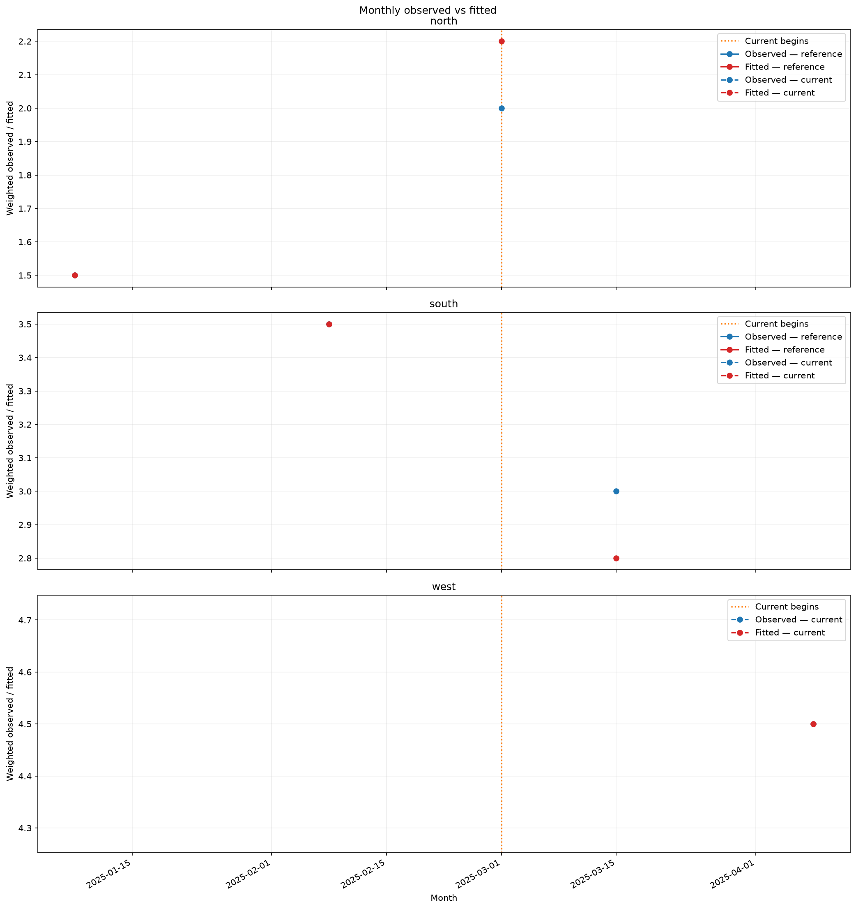
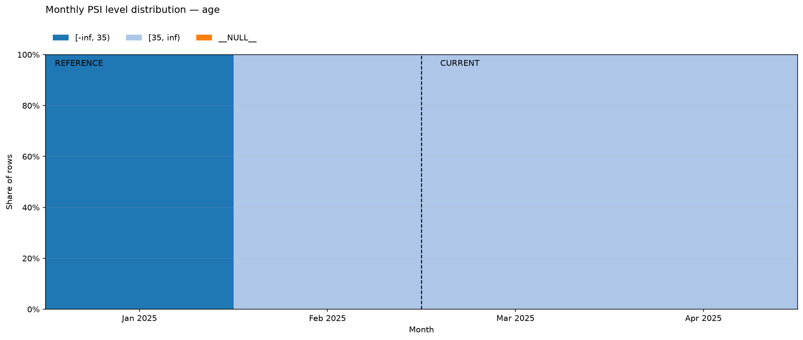
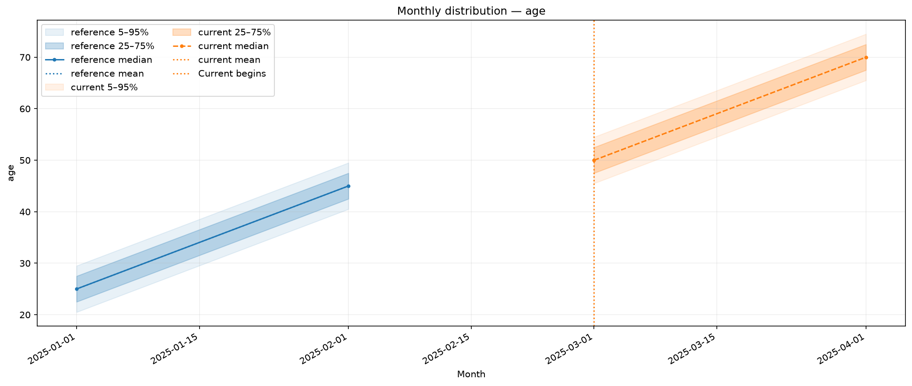
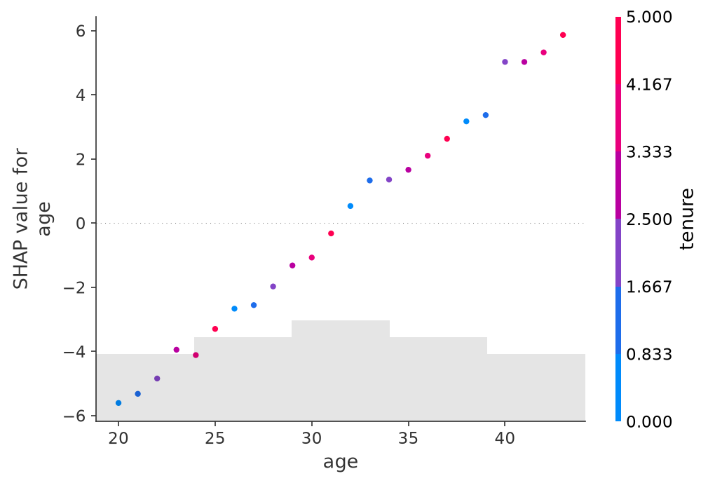

# Plots

Use plotting functions with existing predictions, or enable figures through
`reporting.diagnostics` in the [training configuration](../configuration.md).
Each saving function creates parent directories, writes the figure, and closes
it. `binary_curves` only calculates a table and does not save a figure.

## Choose a plot

| Question | Functions |
| --- | --- |
| How do precision, recall, F1, and calibration behave? | `classification.precision_recall`, `f1_threshold`, `calibration` |
| Where do predictions differ from observations? | `regression.observed_fitted`, `observed_fitted_by_level`, `monthly_observed_fitted` |
| How much outcome is captured at a given exposure share? | `ranking.gains_curve`, `lift_curve` |
| How are known positives ranked among unlabeled rows? | `pu.score_distribution`, `positive_capture` |
| Which feature distributions have shifted? | `psi.feature_psi_plot`, `monthly_psi_level_distribution` |
| How does a numerical feature change over time? | `monitoring.monthly_feature_distribution` |
| Which features contribute most to predictions? | `explainability.feature_importance`, `shap_importance`, `shap_beeswarm`, `shap_dependence` |

## Prepare example inputs

The following recipes share these small arrays and Polars frames. Numerical
vectors are one-dimensional and aligned within each sample. Plot APIs accepting
`array-like` also accept numerical Python lists; categorical feature values may
be strings. Use `Path` objects throughout, including for the PSI and ranking
functions whose signatures require them.

<!-- example: plots-setup -->
```python
from datetime import date
from pathlib import Path

import numpy as np
import polars as pl

from ml_toolkit.config import FigureConfig

output = Path("figures")
figure = FigureConfig(dpi=150)
observed = np.array([0.0, 0.0, 1.0, 1.0])
probabilities = np.array([0.1, 0.6, 0.7, 0.9])
reference = pl.DataFrame(
    {"age": [20, 30, 40, 50], "region": ["north", "north", "south", "south"]}
)
current = pl.DataFrame(
    {"age": [45, 55, 65, 75], "region": ["north", "south", "west", "west"]}
)
reference_time = [date(2025, 1, 1), date(2025, 1, 15), date(2025, 2, 1), date(2025, 2, 15)]
current_time = [date(2025, 3, 1), date(2025, 3, 15), date(2025, 4, 1), date(2025, 4, 15)]
reference_y = np.array([1.0, 2.0, 3.0, 4.0])
reference_prediction = np.array([1.2, 1.8, 3.2, 3.8])
current_y = np.array([2.0, 3.0, 4.0, 5.0])
current_prediction = np.array([2.2, 2.8, 4.2, 4.8])
```

`FigureConfig` controls dimensions, DPI, and format. For example,
`FigureConfig(format="svg")` replaces the requested filename suffix with
`.svg`. The numerical tables returned by a plot are unaffected by export settings.

## Classification curves and calibration

<!-- example: plots-binary-curves -->
```python
from ml_toolkit.plots import classification

curve = classification.binary_curves(observed, probabilities)
print(curve.round(3).to_string(index=False))
```

<!-- output: plots-binary-curves -->
```text
 threshold  precision  recall    f1
       0.9      1.000     0.5 0.667
       0.7      1.000     1.0 1.000
       0.6      0.667     1.0 0.800
       0.1      0.500     1.0 0.667
```
<!-- /output -->

The table contains every distinct threshold, in descending order. At `0.6`,
three rows are selected: precision is `2 / 3` and recall is `1.0`. All tied
scores enter together, using a probability at or above the threshold.

### Precision and recall

<!-- example: plots-precision-recall -->
```python
precision_recall_table = classification.precision_recall(
    observed, probabilities, output / "precision-recall.png", figure=figure
)
```


### F1 by threshold

<!-- example: plots-f1-threshold -->
```python
f1_table = classification.f1_threshold(
    observed, probabilities, output / "f1-threshold.png", figure=figure
)
```


Both functions return the full pandas threshold table, even when the rendered
curve uses a configured point limit.

### Calibration

<!-- example: plots-calibration -->
```python
from ml_toolkit.config import ClassificationPlotsConfig

calibration_table = classification.calibration(
    observed,
    probabilities,
    output / "calibration.png",
    config=ClassificationPlotsConfig(calibration_bins=2),
    figure=figure,
)
print(calibration_table.round(3).to_string(index=False))
```

<!-- output: plots-calibration -->
```text
 bin  observed_rate  predicted_rate  count
   0            0.0            0.35      2
   1            1.0            0.80      2
```
<!-- /output -->


Calibration returns populated bins with unweighted observed/predicted rates and
row counts. All classification plots are unweighted and require confirmed
binary ground truth. PU labels need the separate PU functions below.

## Observed versus fitted

For a quick plot, let `observed_fitted` group a categorical feature or bin a
numerical feature into quantiles. Its pandas result contains `feature`,
`observed`, `fitted`, and `volume`; volume is total weight or row count.

<!-- example: plots-observed-fitted -->
```python
from ml_toolkit.plots import regression

by_feature = regression.observed_fitted(
    reference["age"].to_numpy(),
    reference_y,
    reference_prediction,
    output / "observed-fitted.png",
    feature_name="Age",
    n_bins=2,
    figure=figure,
)
print(by_feature.round(3).to_string(index=False))
```

<!-- output: plots-observed-fitted -->
```text
       feature  observed  fitted  volume
(19.999, 35.0]       1.5     1.5     2.0
  (35.0, 50.0]       3.5     3.5     2.0
```
<!-- /output -->


For comparable train/current groups, fit levels once on the reference and reuse
them. This keeps numerical boundaries and special levels consistent across
samples; an unseen category uses the fitted unseen level.

<!-- example: plots-observed-fitted-levels -->
```python
from ml_toolkit.config import FeatureLevelSpec
from ml_toolkit.feature_levels import LevelTransformer

levels = LevelTransformer((FeatureLevelSpec("region", "categorical"),)).fit(reference)
reference_levels = levels.transform(reference)
current_levels = levels.transform(current)
assert levels.config is not None
by_level = regression.observed_fitted_by_level(
    reference_levels["region"],
    reference_y,
    reference_prediction,
    current_levels["region"],
    current_y,
    current_prediction,
    output / "observed-fitted-levels.png",
    level_order=levels.config.features[0].levels,
    reference_label="Train",
    current_label="Test",
    figure=figure,
)
print(by_level.round(3).to_string(index=False))
```

<!-- output: plots-observed-fitted-levels -->
```text
   sample      level  observed  fitted  volume
reference      north       1.5     1.5     2.0
reference      south       3.5     3.5     2.0
reference __UNSEEN__       NaN     NaN     0.0
  current      north       2.0     2.2     1.0
  current      south       3.0     2.8     1.0
  current __UNSEEN__       4.5     4.5     2.0
```
<!-- /output -->


`by_level` is a pandas DataFrame in the supplied level order. Its `sample`
values remain `reference` and `current`; legend labels affect only the figure.
Groups absent from one sample have zero volume and NaN means there.

<!-- example: plots-monthly-observed-fitted -->
```python
monthly = regression.monthly_observed_fitted(
    reference_time,
    reference_y,
    reference_prediction,
    current_time,
    current_y,
    current_prediction,
    output / "monthly-observed-fitted.png",
    reference_group=reference["region"],
    current_group=current["region"],
    figure=figure,
)
print(monthly[["month", "group", "split", "observed", "fitted", "volume"]].round({"observed": 3, "fitted": 3, "volume": 3}).to_string(index=False))
```

<!-- output: plots-monthly-observed-fitted -->
```text
     month group     split  observed  fitted  volume
2025-01-01 north reference       1.5     1.5     2.0
2025-02-01 south reference       3.5     3.5     2.0
2025-03-01 north   current       2.0     2.2     1.0
2025-03-01 south   current       3.0     2.8     1.0
2025-04-01  west   current       4.5     4.5     2.0
```
<!-- /output -->



The monthly pandas table also includes `plot_date`, the mean observation time
used for positioning. Dates are normalized to UTC. Omit the two group arguments
for one curve per sample. All three regression functions accept optional
nonnegative weights with positive total per sample. Quick feature and monthly
plots omit zero-weight groups. The shared-level plot keeps a level when either
sample has positive weight, showing NaN means for the other sample if its
weight is zero.

## Gains and lift

<!-- example: plots-gains -->
```python
from ml_toolkit.metrics import ranking_metrics
from ml_toolkit.plots import ranking

ranked = ranking_metrics(
    observed, probabilities, np.ones(4), selected_percents=(25.0,)
)
ranking.gains_curve(ranked, output / "gains.png", figure=figure)
```


<!-- example: plots-lift -->
```python
ranking.lift_curve(ranked, output / "lift.png", figure=figure)
print([(point.percent, point.gain, point.lift) for point in ranked.selected_points])
```

<!-- output: plots-lift -->
```text
[(25.0, 0.5, 2.0)]
```
<!-- /output -->


Both plotting calls return `None`; calculate the reusable `RankingMetrics`
first. Capacity is a share of total exposure, and gains measure the share of
`observed * exposure` captured. Scores determine descending order. These plots
are suitable for supervised outcomes, including rates with exposure weights.

## Positive-unlabeled plots

<!-- example: plots-pu-distribution -->
```python
from ml_toolkit.config import PUPlotsConfig
from ml_toolkit.plots import pu

pu_labels = np.array([1.0, 0.0, 1.0, 0.0])
pu_probabilities = np.array([0.9, 0.8, 0.4, 0.2])
pu.score_distribution(
    pu_labels,
    pu_probabilities,
    output / "pu-distribution.png",
    config=PUPlotsConfig(histogram_bins=10),
    figure=figure,
)
```


<!-- example: plots-pu-capture -->
```python
pu.positive_capture(
    pu_labels, pu_probabilities, output / "pu-capture.png", figure=figure
)
```


Both calls return `None`. Labels are `1` for known positives and `0` for
unlabeled rows. Both groups must have positive total weight; omit `weights` for
equal weights. Score histograms normalize each group separately. Capture plots
show known positives captured against the unlabeled fraction reviewed, with
both axes in percent. Unlabeled rows are not confirmed negatives.

## PSI scores and monthly level shares

<!-- example: plots-psi-scores -->
```python
from ml_toolkit.psi import PSIAnalysis, PSIConfig
from ml_toolkit.plots import psi

analysis = PSIAnalysis(
    PSIConfig(features=(FeatureLevelSpec("age", "numerical"),), n_bins=2)
).fit(reference, time=pl.Series("date", reference_time))
comparison = analysis.compare(current, time=pl.Series("date", current_time))
psi.feature_psi_plot(comparison.psi, output / "psi-scores.png", figure=figure)
```


<!-- example: plots-psi-monthly -->
```python
psi.monthly_psi_level_distribution(
    comparison.monthly_distribution, "age", output / "psi-monthly.png", figure=figure
)
```



Both calls return `None`. Reuse the tables from `PSIAnalysis` rather than
constructing their schemas by hand. The first plot compares PSI scores across
features. The second displays monthly shares on the reference-fitted levels and
marks where current observations begin. Supply timestamps to both `fit` and
`compare` to obtain monthly distributions. See the [PSI guide](psi.md) for
reusing the same reference across subsequent batches.

## Monthly numerical distributions

<!-- example: plots-monthly-age -->
```python
from ml_toolkit.plots import monitoring

monthly_distribution = monitoring.monthly_feature_distribution(
    reference.with_columns(pl.Series("date", reference_time)),
    current.with_columns(pl.Series("date", current_time)),
    "age",
    "date",
    output / "monthly-age.png",
    figure=figure,
)
print(monthly_distribution.select("month", "split", "p50", "mean").write_csv(), end="")
```

<!-- output: plots-monthly-age -->
```text
month,split,p50,mean
2025-01-01,reference,25.0,25.0
2025-02-01,reference,45.0,45.0
2025-03-01,current,50.0,50.0
2025-04-01,current,70.0,70.0
```
<!-- /output -->



This returns a Polars DataFrame. By default the chart shows 5–95% and 25–75%
bands, median, and mean. Pass `NumericalFeatureDistributionConfig` through
`config` to choose quantile bands or hide curves. Summaries are unweighted;
null/non-finite feature values are omitted. The timestamp column must have a
Polars Date or Datetime dtype.

## Feature importance

<!-- example: plots-feature-importance -->
```python
from ml_toolkit.plots import explainability

importance_table = explainability.feature_importance(
    ["age", "region"],
    np.array([0.7, 0.3]),
    output / "feature-importance.png",
    max_features_display=2,
    figure=figure,
)
print(importance_table.to_string(index=False))
```

<!-- output: plots-feature-importance -->
```text
feature  importance
    age         0.7
 region         0.3
```
<!-- /output -->


Supply importance values from your model or calculation. The pandas result has
`feature` and `importance` columns in descending order, limited to the displayed
features. No fitted backend is required for this function.

## Plot SHAP explanations

Install the optional `shap` extra. This complete example fits a small native
CatBoost regressor to age and tenure effects, so its contributions are visible.
For an existing toolkit adapter, pass `model.native_model` and your own Polars
features instead. The shared `output` and `figure` above control the saved files.

<!-- example: plots-shap-importance -->
```python
from catboost import CatBoostRegressor

from ml_toolkit.config import ShapConfig
from ml_toolkit.explainability import calculate_shap_values
from ml_toolkit.plots import explainability

shap_features = pl.DataFrame(
    {"age": list(range(20, 44)), "tenure": [i % 6 for i in range(24)]}
)
shap_target = 0.5 * shap_features["age"] + 2.0 * shap_features["tenure"]
shap_model = CatBoostRegressor(
    iterations=40,
    depth=3,
    random_seed=42,
    thread_count=2,
    verbose=False,
    allow_writing_files=False,
).fit(shap_features.to_pandas(), shap_target.to_numpy())
shap_config = ShapConfig(max_samples=24, max_display=2, seed=42)
explanation = calculate_shap_values(shap_model, shap_features, config=shap_config)
explainability.shap_importance(
    explanation, output / "shap-importance.png", config=shap_config, figure=figure
)
```


<!-- example: plots-shap-beeswarm -->
```python
explainability.shap_beeswarm(
    explanation, output / "shap-beeswarm.png", config=shap_config, figure=figure
)
```


<!-- example: plots-shap-age -->
```python
explainability.shap_dependence(
    explanation, "age", output / "shap-age.png", figure=figure
)
```



All three plotting functions return `None`. `calculate_shap_values` samples at
most `max_samples` rows and returns a single-output `shap.Explanation`. Bar
plots summarize mean absolute contributions; beeswarms show their spread;
dependence plots show one feature's contribution against its value. The
contributions explain the native raw score, which can differ from final
probabilities or log-link predictions. Sampling happens during calculation;
the plotting `config` controls only the maximum displayed feature count.

## Regenerate the gallery

From a source checkout with the `shap` extra installed, run:

```bash
python -m examples.render_plots
```

This executes the documented recipes, refreshes their captured output and the
17 PNGs in `docs/assets/plots`, and checks the returned summaries and figure
cleanup. Use `--check` to verify captured output and render temporary figures
without changing the checked-in gallery. To refresh captured console output
across all documentation pages and regenerate this gallery together, run
`python -m examples.render_examples`; add `--check` to verify everything.

## API reference

Import plotting modules from `ml_toolkit.plots`. Each reference entry describes
accepted inputs, returned tables, and validation constraints.

### Classification

::: ml_toolkit.plots.classification
    options:
      show_root_heading: false
      heading_level: 4
      members: [binary_curves, precision_recall, f1_threshold, calibration]

### Regression

::: ml_toolkit.plots.regression
    options:
      show_root_heading: false
      heading_level: 4
      members: [observed_fitted, observed_fitted_by_level, monthly_observed_fitted]

### Ranking

::: ml_toolkit.plots.ranking
    options:
      show_root_heading: false
      heading_level: 4
      members: [gains_curve, lift_curve]

### Positive-unlabeled

::: ml_toolkit.plots.pu
    options:
      show_root_heading: false
      heading_level: 4
      members: [score_distribution, positive_capture]

### PSI

::: ml_toolkit.plots.psi
    options:
      show_root_heading: false
      heading_level: 4
      members: [feature_psi_plot, monthly_psi_level_distribution]

### Monitoring

::: ml_toolkit.plots.monitoring
    options:
      show_root_heading: false
      heading_level: 4
      members: [monthly_feature_distribution]

### Explainability

::: ml_toolkit.plots.explainability
    options:
      show_root_heading: false
      heading_level: 4
      members: [feature_importance, shap_importance, shap_beeswarm, shap_dependence]
