# Plots

Use plotting functions with existing predictions, or enable figures through
`reporting.diagnostics` in the [training configuration](../configuration.md).
Each saving function creates parent directories, writes the figure, and closes
it. `binary_curves` only calculates a table.

## Choose a plot

| Question | Functions |
| --- | --- |
| How do precision, recall, F1, and calibration behave? | `classification.precision_recall`, `f1_threshold`, `calibration` |
| Where do predictions differ from observations? | `regression.observed_fitted`, `observed_fitted_by_level`, `time_observed_fitted` |
| How much outcome is captured at a given capacity? | `ranking.gains_curve`, `lift_curve` |
| How are known positives ranked among unlabeled rows? | `pu.score_distribution`, `positive_capture` |
| Which feature distributions have shifted? | `psi.feature_psi_plot`, `time_psi_level_distribution` |
| How does a numerical feature change over time? | `monitoring.time_feature_distribution` |
| Which features contribute most to predictions? | `explainability.feature_importance`, `shap_importance`, `shap_beeswarm`, `shap_dependence` |

All temporal functions accept `period="month"` by default. Supported values
are `minute`, `hour`, `day`, `week`, `month`, `quarter`, and `year`. They group in
the input timezone; both samples must have matching timezones. Weeks begin on
Monday and quarters are calendar quarters. Minute/hour require `Datetime`, not
`Date`. Returned `period_start` values preserve the timezone and are truncated
to the start of the selected period.
Points are drawn at period starts. Entirely missing periods have no computed
values or markers; lines simply connect neighboring observed periods.

Time ranges must satisfy
`max(reference_timestamp) <= min(current_timestamp)`. Equal endpoints are
allowed; overlap beyond the shared endpoint and reversed samples raise
`ValueError`. This check uses the
original timestamps, so a split inside a month (or any other grouping period)
is allowed. Line plots retain separate reference/current points at that
period's start.

Classification functions accept `weight=`. Precision, recall, F1, prevalence,
AP, calibration means and histograms use it; omitted weights mean ones, and
zero-weight rows are ignored. Calibration bin boundaries remain unweighted
quantiles of positive-weight rows; its `count` column counts those rows and
`weight_sum` reports their weight.

## Prepare real example data

These examples use measured observations and fitted models. Classification uses
scikit-learn's [handwritten digits dataset](https://scikit-learn.org/stable/modules/generated/sklearn.datasets.load_digits.html):
1,797 images, with digits 0–4 as class 0 and 5–9 as class 1. A fixed stratified
split reserves 719 images for evaluation; the model fits only the other 1,078.
The precision, recall, F1, and calibration figures use its held-out probabilities.

Regression uses the [UCI Bike Sharing dataset](https://archive.ics.uci.edu/dataset/275/bike+sharing+dataset),
17,379 hourly observations with genuine dates, weather, calendar covariates, and
rental counts. Data attribution: Hadi Fanaee-T, UCI Machine Learning Repository,
CC BY 4.0. A CatBoost regressor fits January–June 2011. July–December 2011
is the reference period and all of 2012 is the current period. Both plotted
periods are held out from fitting. Dates come from the recorded date and hour;
the monthly figures show actual calendar periods. The target is hourly `cnt`;
`casual` and `registered`, whose sum reveals the target, are excluded from
features. Temperature and humidity retain the source dataset's normalized scales.

From an installed source checkout, run `python -m examples.prepare_data` once
to cache the original sources. Then load the shared data and fitted models below.
Recipe execution requires those caches and never downloads missing data. The
canonical loader contains the exact splits and model settings.

<!-- example: plots-setup -->
```python
from pathlib import Path

import numpy as np
import polars as pl

from examples.gallery_data import load_gallery_data
from ml_toolkit.config import FigureConfig

digits, bikes = load_gallery_data(download_if_missing=False)
observed, probabilities = digits.observed, digits.probabilities
reference, current = bikes.reference.features, bikes.current.features
reference_y, current_y = bikes.reference.observed, bikes.current.observed
reference_prediction = bikes.reference.prediction
current_prediction = bikes.current.prediction
reference_time = bikes.reference.time.to_list()
current_time = bikes.current.time.to_list()
output = Path("figures")
figure = FigureConfig(dpi=150)
print(f"Digits: {len(digits.train_indices)} training / {len(observed)} held-out images")
print(f"Bikes: {len(bikes.train_indices)} training / {len(reference)} reference / {len(current)} current hours")
```

<!-- output: plots-setup -->
```text
Digits: 1078 training / 719 held-out images
Bikes: 4250 training / 4395 reference / 8734 current hours
```
<!-- /output -->

??? example "Inspect data preparation and model fitting"

    ```python
    --8<-- "examples/gallery_data.py"
    ```

`FigureConfig` controls dimensions, DPI, and format. For example,
`FigureConfig(format="svg")` replaces the filename suffix with `.svg`.
Use `Path` objects throughout, including for PSI and ranking functions.

## Classification curves and calibration

<!-- example: plots-binary-curves -->
```python
from ml_toolkit.plots import classification

curve = classification.binary_curves(observed, probabilities)
shown = curve.iloc[np.linspace(0, len(curve) - 1, 6, dtype=int)]
print(shown.round(3).to_string(index=False))
print(f"Held-out observations: {len(observed)}; distinct thresholds: {len(curve)}")
```

<!-- output: plots-binary-curves -->
```text
 threshold  precision  recall    f1
     0.999      1.000   0.003 0.006
     0.990      1.000   0.402 0.574
     0.944      1.000   0.804 0.892
     0.057      0.831   1.000 0.907
     0.008      0.623   1.000 0.767
     0.000      0.498   1.000 0.665
Held-out observations: 719; distinct thresholds: 719
```
<!-- /output -->

The complete pandas table contains one row per distinct threshold; the output
above samples six rows. Predictions at or above a threshold are positive and
all tied scores enter together.

### Precision and recall

<!-- example: plots-precision-recall -->
```python
precision_recall_table = classification.precision_recall(
    observed, probabilities, output / "precision-recall.png", figure=figure
)
```

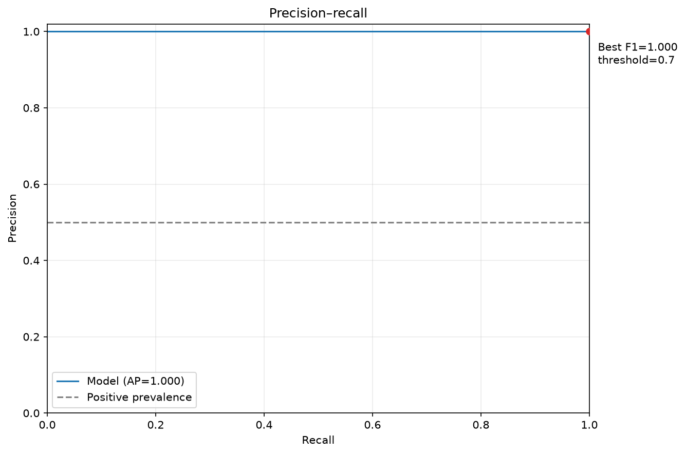

### F1 by threshold

<!-- example: plots-f1-threshold -->
```python
f1_table = classification.f1_threshold(
    observed, probabilities, output / "f1-threshold.png", figure=figure
)
```

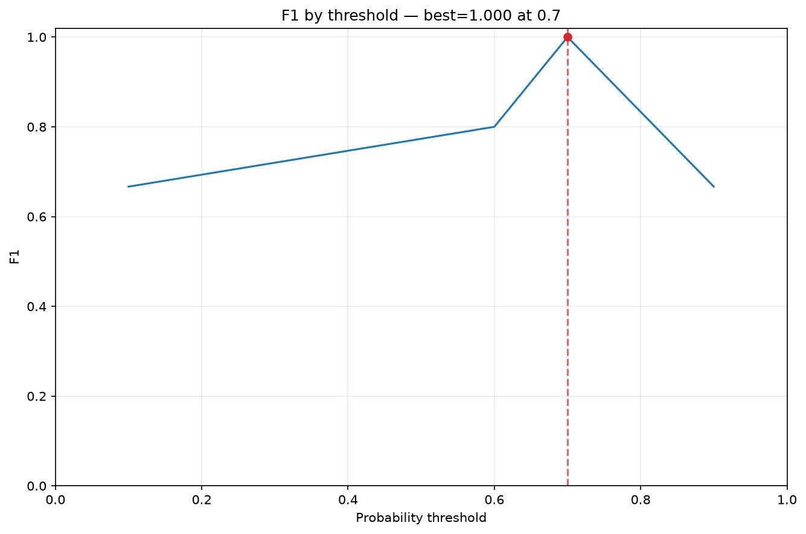

Both functions return the full threshold table even when a rendering point
limit reduces the displayed curve.

### Calibration

<!-- example: plots-calibration -->
```python
from ml_toolkit.config import ClassificationPlotsConfig

calibration_table = classification.calibration(
    observed,
    probabilities,
    output / "calibration.png",
    config=ClassificationPlotsConfig(calibration_bins=10),
    figure=figure,
)
print(calibration_table.round(3).to_string(index=False))
```

<!-- output: plots-calibration -->
```text
 bin  observed_rate  predicted_rate  count  weight_sum
   0          0.000           0.002     72        72.0
   1          0.000           0.005     72        72.0
   2          0.000           0.012     72        72.0
   3          0.000           0.032     72        72.0
   4          0.097           0.157     72        72.0
   5          0.887           0.815     71        71.0
   6          1.000           0.967     72        72.0
   7          1.000           0.986     72        72.0
   8          1.000           0.993     72        72.0
   9          1.000           0.997     72        72.0
```
<!-- /output -->

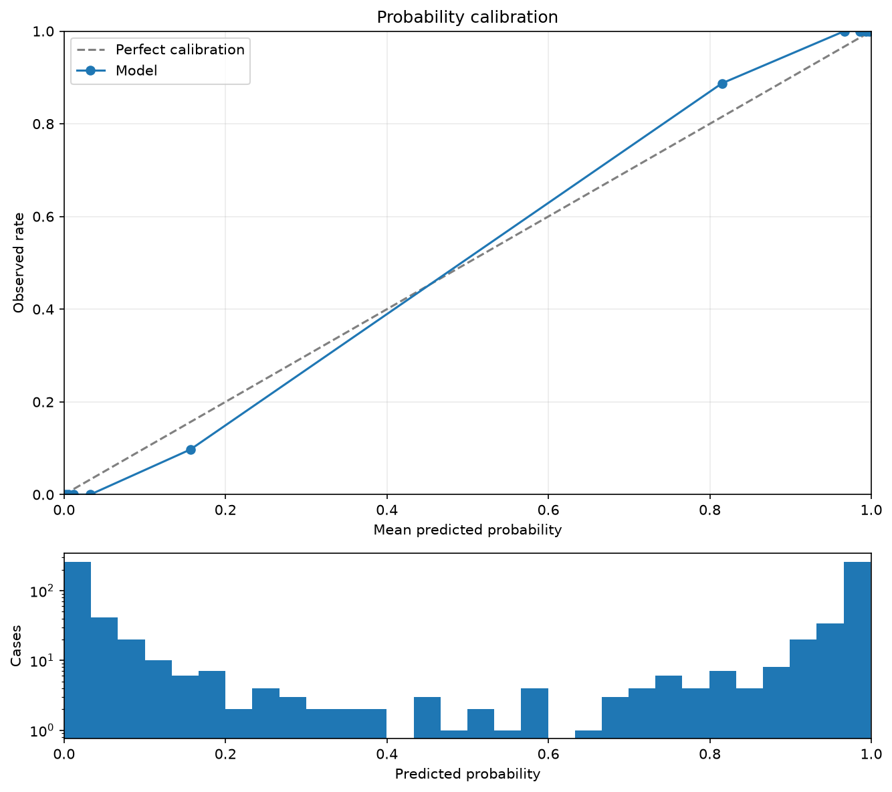

Each bin contains roughly 72 held-out images. The table compares mean predicted
probability with observed positive rate and reports the supporting count.
These classification plots use supplied sample weights and require confirmed ground truth.

## Observed versus fitted

Compare actual hourly bike rentals with the model's predictions. First group
the reference period into ten temperature quantiles. The returned pandas table
contains mean `observed`, mean `fitted`, and `volume` for every feature bin;
without explicit weights, volume is its number of recorded hours.

<!-- example: plots-observed-fitted -->
```python
from ml_toolkit.plots import regression

by_feature = regression.observed_fitted(
    reference["temperature"].to_numpy(),
    reference_y,
    reference_prediction,
    output / "observed-fitted.png",
    feature_name="Normalized temperature",
    n_bins=10,
    figure=figure,
)
print(by_feature.round(2).to_string(index=False))
```

<!-- output: plots-observed-fitted -->
```text
     feature  observed  fitted  volume
(0.139, 0.3]     84.05   76.85   497.0
 (0.3, 0.36]    122.88  109.56   456.0
(0.36, 0.42]    143.49  131.78   392.0
 (0.42, 0.5]    148.08  147.52   515.0
 (0.5, 0.56]    170.36  172.74   431.0
(0.56, 0.62]    147.20  148.69   451.0
(0.62, 0.66]    157.61  166.41   391.0
(0.66, 0.72]    192.97  200.96   514.0
(0.72, 0.78]    242.87  248.28   367.0
(0.78, 0.96]    258.20  278.82   381.0
```
<!-- /output -->

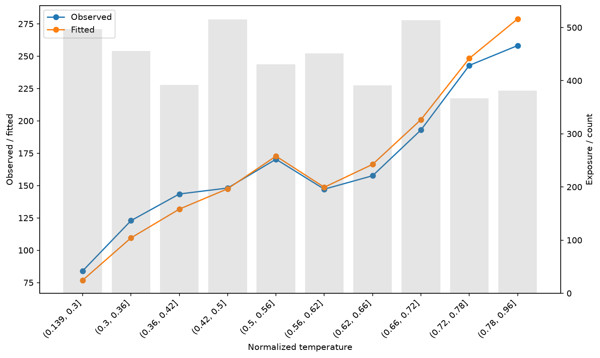

For comparable reference/current groups, fit levels once on the reference and
reuse the same boundaries in the current period. Each level aggregates
hundreds of recorded hours rather than isolated examples.

<!-- example: plots-observed-fitted-levels -->
```python
from ml_toolkit.config import FeatureLevelConfig
from ml_toolkit.feature_levels import LevelTransformer

levels = LevelTransformer(
    (FeatureLevelConfig("temperature", "numerical"),), n_bins=10
).fit(reference)
reference_levels = levels.transform(reference)
current_levels = levels.transform(current)
assert levels.feature_levels is not None
by_level = regression.observed_fitted_by_level(
    reference_levels["temperature"],
    reference_y,
    reference_prediction,
    current_levels["temperature"],
    current_y,
    current_prediction,
    output / "observed-fitted-levels.png",
    level_order=levels.feature_levels[0].levels,
    feature_name="Normalized temperature",
    reference_label="Jul–Dec 2011",
    current_label="2012",
    figure=figure,
)
print(by_level.groupby("sample")[["volume"]].sum().to_string())
print(by_level.head(4).round(2).to_string(index=False))
```

<!-- output: plots-observed-fitted-levels -->
```text
           volume
sample
current    8734.0
reference  4395.0
   sample        level  observed  fitted  volume
reference  [-inf, 0.3)     77.76   71.07   369.0
reference  [0.3, 0.36)    109.52  100.87   407.0
reference [0.36, 0.42)    135.91  120.76   444.0
reference  [0.42, 0.5)    145.87  140.84   515.0
```
<!-- /output -->

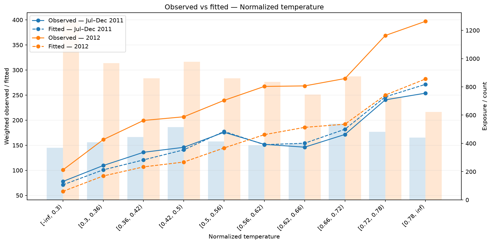

`sample` remains `reference`/`current`; legend labels affect only the figure.
Levels absent from one sample have zero volume and NaN means for that sample.

<!-- example: plots-time-observed-fitted -->
```python
temporal = regression.time_observed_fitted(
    reference_time,
    reference_y,
    reference_prediction,
    current_time,
    current_y,
    current_prediction,
    output / "time-observed-fitted.png",
    figure=figure,
)
summary = temporal[["period_start", "split", "observed", "fitted", "volume"]]
print(summary.head(6).round({"observed": 2, "fitted": 2}).to_string(index=False))
print(f"Monthly summaries: {len(temporal)}; minimum hours per month: {int(temporal.volume.min())}")
```

<!-- output: plots-time-observed-fitted -->
```text
period_start     split  observed  fitted  volume
  2011-07-01 reference    189.97  200.42   744.0
  2011-08-01 reference    186.99  201.52   731.0
  2011-09-01 reference    177.71  178.78   717.0
  2011-10-01 reference    166.23  154.92   743.0
  2011-11-01 reference    142.10  137.59   719.0
  2011-12-01 reference    117.84  113.86   741.0
Monthly summaries: 18; minimum hours per month: 692
```
<!-- /output -->

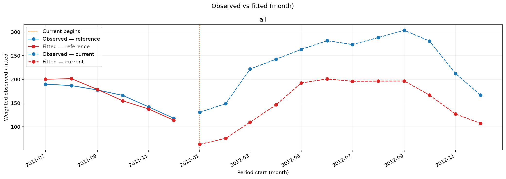

This uses the six actual reference months and twelve actual current months.
Each point summarizes hundreds of hours. The model was fitted before both
periods, so the gap includes genuine later-period prediction error. Changes
in weather, calendar mix, and demand can all affect these comparisons;
a figure alone does not establish a cause. The simple RMSE fit permits negative
individual predictions; the gallery preserves its raw outputs.

The temporal table contains `period_start`, the calendar-period start used
for positioning. Dates retain their original time zone and calendar boundaries. Optional group Series add
separate curves; optional weights change means and volumes.

## Gains and lift

Rank the held-out bike hours by predicted demand and inspect the fraction of
recorded rentals captured in the highest-scored hours. Unit exposure makes
capacity a fraction of hours.

<!-- example: plots-gains -->
```python
from ml_toolkit.metrics import ranking_metrics
from ml_toolkit.plots import ranking

ranked = ranking_metrics(
    bikes.observed, bikes.prediction, bikes.weight, selected_percents=(10.0, 20.0)
)
ranking.gains_curve(ranked, output / "gains.png", figure=figure)
```

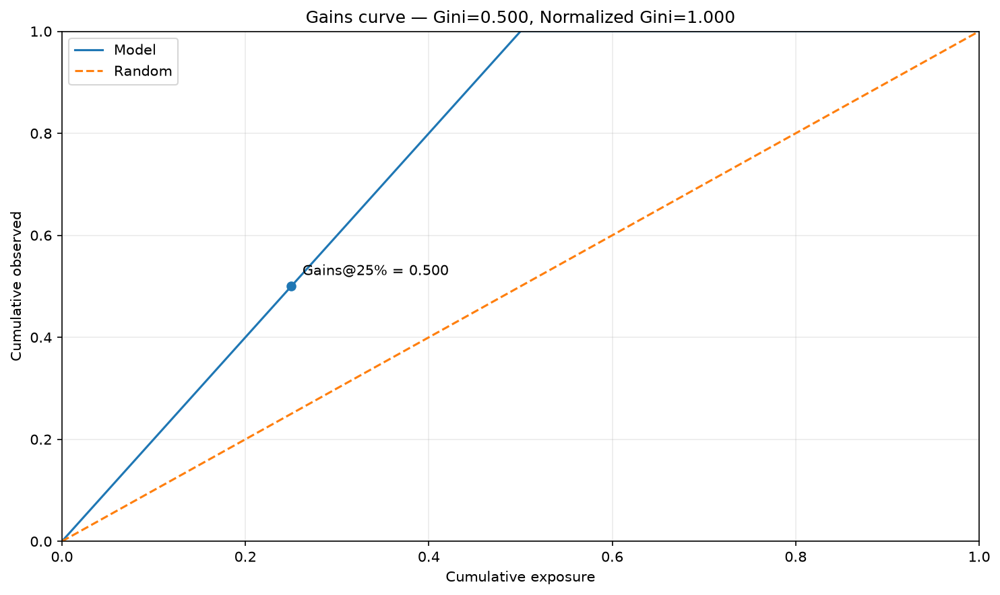

<!-- example: plots-lift -->
```python
ranking.lift_curve(ranked, output / "lift.png", figure=figure)
print([(point.percent, round(point.gain, 3), round(point.lift, 3)) for point in ranked.selected_points])
```

<!-- output: plots-lift -->
```text
[(10.0, 0.268, 2.68), (20.0, 0.463, 2.315)]
```
<!-- /output -->

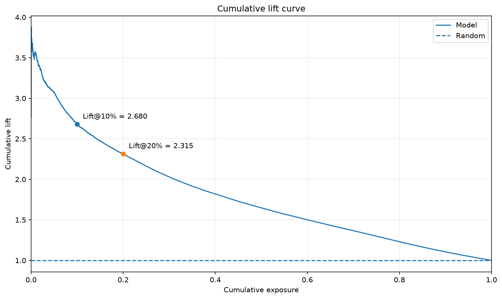

Both plotting calls return `None`; calculate reusable `RankingMetrics` first.
Gain is the share of `observed * exposure` captured, and lift divides gain by
the exposure fraction. These plots require supervised outcomes.

## Positive-unlabeled plots

Use the [original LINQS Cora archive](https://linqs-data.soe.ucsc.edu/public/lbc/cora.tgz)
for an observed-link retrieval example: 2,708 real papers, their 1,433 binary
word indicators, and all 5,429 recorded directed citations. Recorded links are
known positives. The loader selects 20,000 distinct unrecorded directed pairs
as unverified candidates; their citation status is unknown. It never hides
recorded links or generates replacement labels.

Scores are cosine similarities between the source word vectors. They are
retrieval scores in `[0, 1]`, without a probability interpretation or fitted PU
classifier. Cora's published document classes are unused. This constructs an
open-world citation retrieval example; the sampled candidate ratio does not
estimate citation prevalence.

<!-- example: plots-pu-distribution -->
```python
from examples.citation_data import load_citation_gallery
from ml_toolkit.config import PUPlotsConfig
from ml_toolkit.plots import pu

citations = load_citation_gallery(download_if_missing=False)
pu_labels, pu_scores = citations.labels, citations.scores
pu.score_distribution(
    pu_labels,
    pu_scores,
    output / "pu-distribution.png",
    config=PUPlotsConfig(histogram_bins=30),
    figure=figure,
)
print(f"Cora: {citations.paper_count} papers, {citations.known_citation_count} recorded citations, {citations.unlabeled_pair_count} unverified candidate pairs")
```

<!-- output: plots-pu-distribution -->
```text
Cora: 2708 papers, 5429 recorded citations, 20000 unverified candidate pairs
```
<!-- /output -->

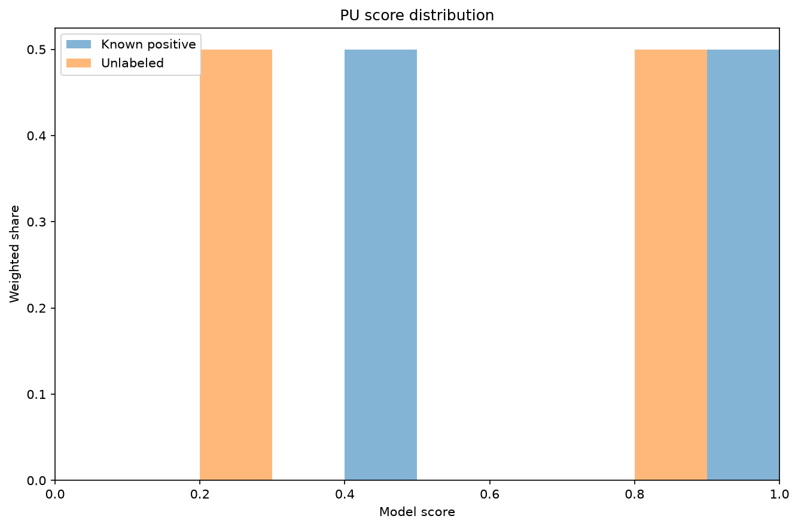

??? example "Inspect Cora records, candidate selection, and similarity scoring"

    ```python
    --8<-- "examples/citation_data.py"
    ```

<!-- example: plots-pu-capture -->
```python
pu.positive_capture(
    pu_labels, pu_scores, output / "pu-capture.png", figure=figure
)
```

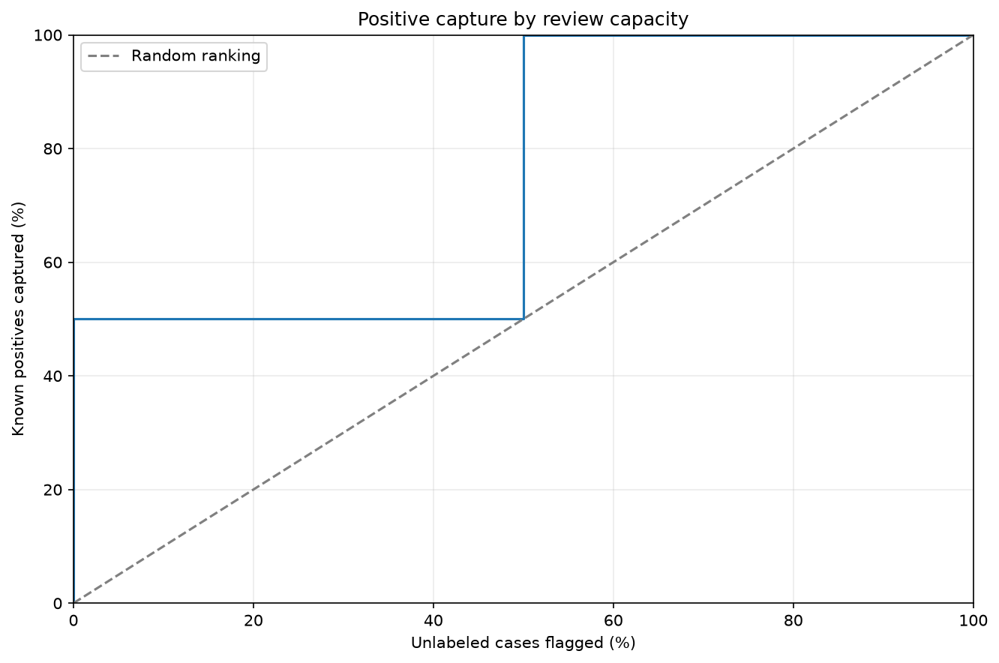

Both calls return `None`. Histograms normalize the recorded-link and candidate
sets separately. Capture plots show recorded citations recovered as the
unverified review fraction increases. Missing records are not confirmed
negative citations, and capture on this graph does not establish recall for
all real citations. Both axes show percentages; tied scores enter together.

## PSI scores and temporal level shares

Fit up to ten quantile bins for continuous weather measurements on July–December
2011, then compare their distributions with 2012. Keep calendar and weather
codes as categories: their integer codes do not represent continuous distances.
Calendar changes can be expected: the reference period contains only six months,
so January–June month categories in 2012 use the unseen level.

<!-- example: plots-psi-scores -->
```python
from ml_toolkit.psi import PSIAnalysis, PSIConfig
from ml_toolkit.plots import psi

categorical_features = {"hour", "working_day", "weekday", "holiday", "season", "weather", "month"}
analysis = PSIAnalysis(
    PSIConfig(
        features=tuple(
            FeatureLevelConfig(name, "categorical" if name in categorical_features else "numerical")
            for name in reference.columns
        ),
        n_bins=10,
    )
).fit(reference, time=bikes.reference.time)
comparison = analysis.compare(current, time=bikes.current.time)
psi.feature_psi_plot(comparison.psi, output / "psi-scores.png", figure=figure)
print(comparison.psi.sort("psi", descending=True).head(5).with_columns(pl.col("psi").round(3)).write_csv(), end="")
```

<!-- output: plots-psi-scores -->
```text
feature,psi
month,6.892
season,3.698
humidity,0.125
feels_like_temperature,0.081
temperature,0.059
```
<!-- /output -->

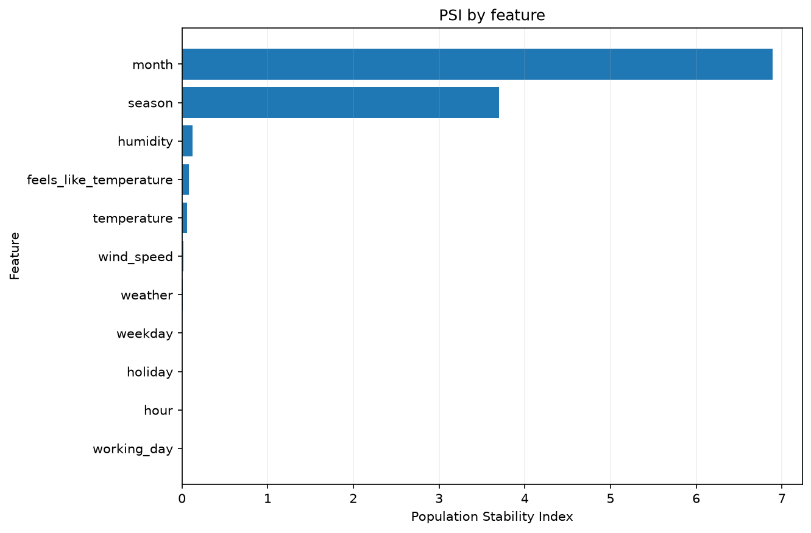

<!-- example: plots-psi-time -->
```python
psi.time_psi_level_distribution(
    comparison.time_distribution,
    "temperature",
    output / "psi-time.png",
    figure=figure,
)
```

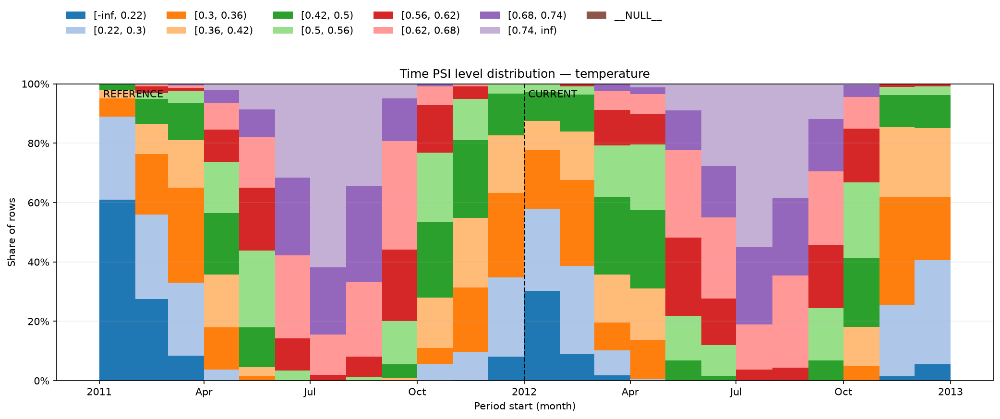

Both calls return `None`. The second plot shows how reference-fitted temperature
levels vary by recorded period on one calendar axis, with a dashed boundary
at the first current bar. If the split falls inside a period, that boundary
period contains two equal-width bars, reference then current. The separator
marks their visual boundary, not the exact split date. Empty periods remain
empty. Reuse the validated tables
from `PSIAnalysis`; see the [PSI guide](psi.md) for their schemas and reuse.

## Numerical distributions over time

Inspect actual humidity distributions alongside the rental-prediction plots.
This exposes the seasonal range of a measured covariate without inventing a
time axis.

<!-- example: plots-time-humidity -->
```python
from ml_toolkit.plots import monitoring

time_distribution = monitoring.time_feature_distribution(
    reference.with_columns(bikes.reference.time.alias("timestamp")),
    current.with_columns(bikes.current.time.alias("timestamp")),
    "humidity",
    "timestamp",
    output / "time-humidity.png",
    figure=figure,
)
print(time_distribution.select("period_start", "split", "p50", "mean").head(6).with_columns(pl.col("mean").round(3)).write_csv(), end="")
```

<!-- output: plots-time-humidity -->
```text
period_start,split,p50,mean
2011-07-01T00:00:00.000000,reference,0.59,0.59
2011-08-01T00:00:00.000000,reference,0.65,0.626
2011-09-01T00:00:00.000000,reference,0.79,0.784
2011-10-01T00:00:00.000000,reference,0.73,0.707
2011-11-01T00:00:00.000000,reference,0.67,0.675
2011-12-01T00:00:00.000000,reference,0.63,0.65
```
<!-- /output -->

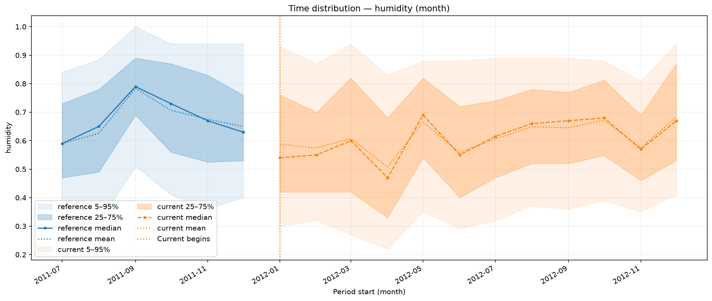

The Polars result contains one row per recorded period and sample. By default
the plot shows 5–95% and 25–75% bands, median, and mean. Pass
`NumericalFeatureDistributionConfig` to choose bands or hide curves.
Summaries are unweighted; null/non-finite feature values are omitted.

For a shorter calendar interval, use the same recorded timestamps with
`period="week"`. Each point below is the Monday starting its observed week.

<!-- example: plots-weekly-humidity -->
```python
weekly_distribution = monitoring.time_feature_distribution(
    reference.with_columns(bikes.reference.time.alias("timestamp")),
    current.with_columns(bikes.current.time.alias("timestamp")),
    "humidity", "timestamp", output / "time-humidity-week.png",
    period="week", figure=figure,
)
print(weekly_distribution.select("period_start", "split", "p50", "mean").head(3).with_columns(pl.col("mean").round(3)).write_csv(), end="")
```

<!-- output: plots-weekly-humidity -->
```text
period_start,split,p50,mean
2011-06-27T00:00:00.000000,reference,0.53,0.508
2011-07-04T00:00:00.000000,reference,0.66,0.653
2011-07-11T00:00:00.000000,reference,0.56,0.583
```
<!-- /output -->

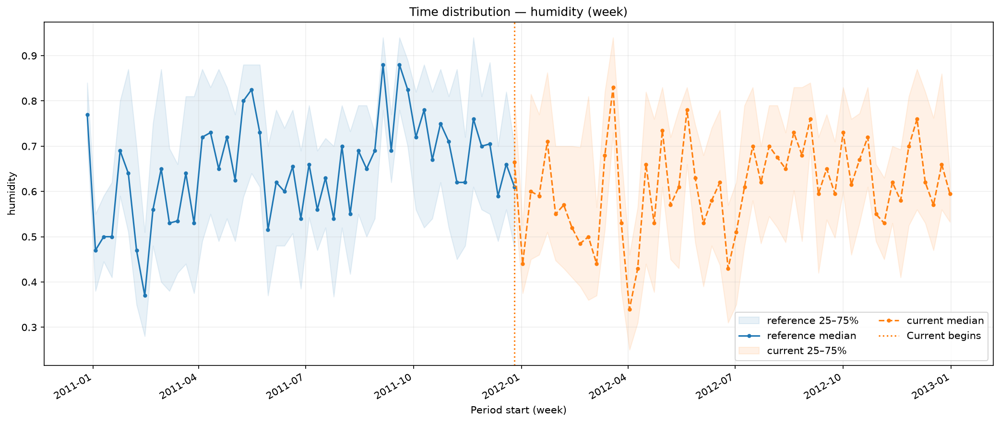

## Feature importance

Use the fitted bike model's native feature importance values. These summarize
the actual model and are not manually assigned scores.

<!-- example: plots-feature-importance -->
```python
from ml_toolkit.plots import explainability

importance_table = explainability.feature_importance(
    list(bikes.importance),
    np.array(list(bikes.importance.values()), dtype=float),
    output / "feature-importance.png",
    max_features_display=11,
    figure=figure,
)
print(importance_table.head(6).round(3).to_string(index=False))
```

<!-- output: plots-feature-importance -->
```text
               feature  importance
                  hour      62.508
           working_day      11.967
feels_like_temperature      10.730
           temperature       5.855
                 month       3.029
              humidity       1.545
```
<!-- /output -->

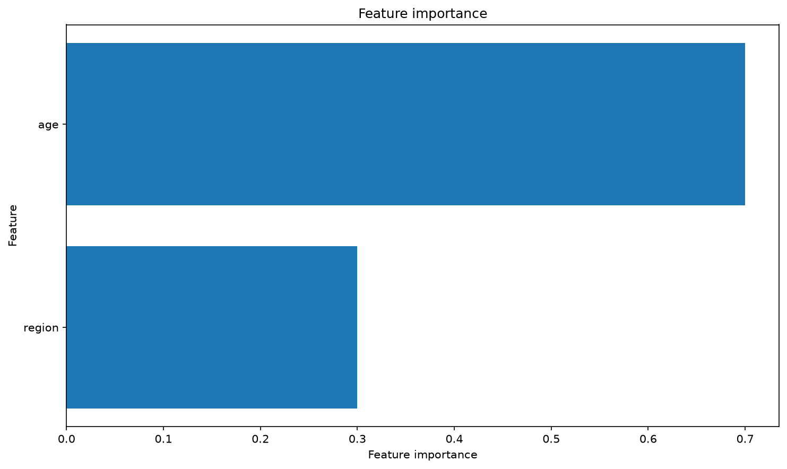

The pandas result has `feature` and `importance` columns, sorted and limited to
the displayed features. The plotting function itself does not require a model;
you supply its importance values.

## Plot SHAP explanations

Install the optional `shap` extra. Explain 600 genuine held-out bike hours
with the same model used for the regression plots; no synthetic targets or
separately invented model are involved.

<!-- example: plots-shap-importance -->
```python
from ml_toolkit.config import ShapConfig
from ml_toolkit.explainability import calculate_shap_values

shap_config = ShapConfig(max_samples=600, max_display=11, seed=42)
explanation = calculate_shap_values(
    bikes.native_model, bikes.shap_features, config=shap_config
)
explainability.shap_importance(
    explanation, output / "shap-importance.png", config=shap_config, figure=figure
)
print(explanation.values.shape)
```

<!-- output: plots-shap-importance -->
```text
(600, 11)
```
<!-- /output -->

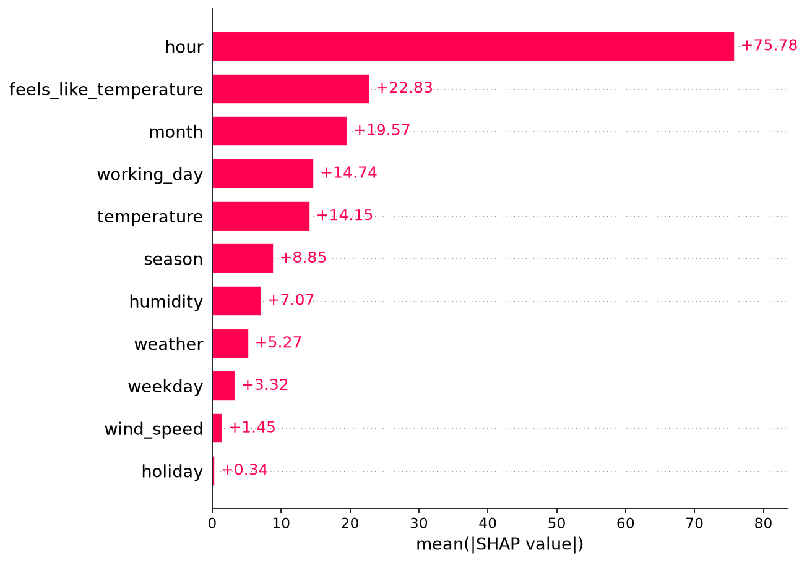

<!-- example: plots-shap-beeswarm -->
```python
explainability.shap_beeswarm(
    explanation, output / "shap-beeswarm.png", config=shap_config, figure=figure
)
```

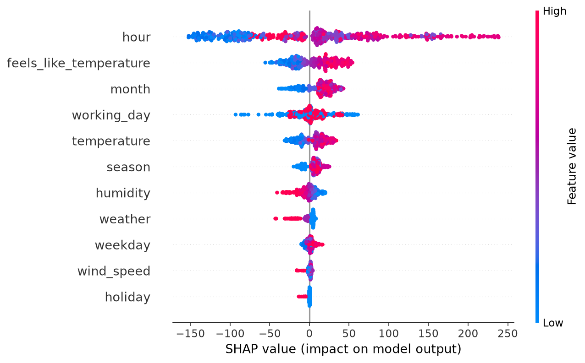

<!-- example: plots-shap-temperature -->
```python
explainability.shap_dependence(
    explanation, "temperature", output / "shap-temperature.png", figure=figure
)
```

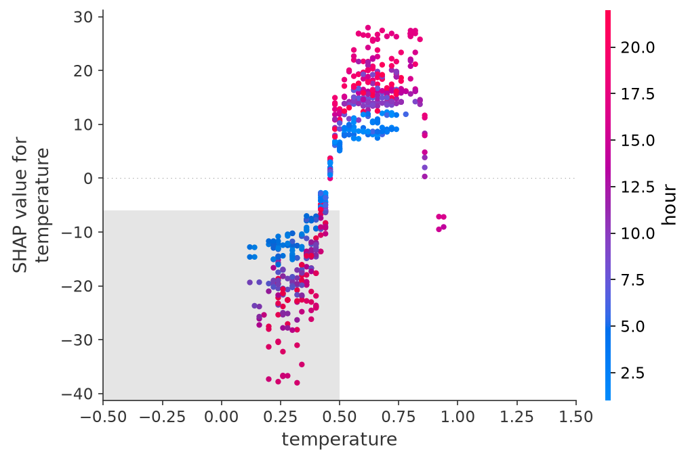

All three plotting functions return `None`. SHAP bars summarize mean absolute
contributions; beeswarms show their per-hour spread; dependence plots display
one feature's effect and interactions. Contributions explain the native raw
prediction scale. Sampling occurs during calculation; plotting `config`
controls the feature display limit.

## Regenerate the gallery

From a source checkout with the `shap` extra installed, run:

```bash
python -m examples.render_plots
```

Prepare the UCI Bike Sharing and LINQS Cora source caches first with
`python -m examples.prepare_data --dataset bike --dataset cora`.
This command executes the documented recipes, refreshes their captured output
and all 18 PNGs, and verifies sample sizes, populated bins, numerical summaries,
and figure cleanup. `--check` verifies output and compares temporary figures
with the checked-in PNGs (pixel RMS tolerance 1 on the 0–255 scale)
without changing the checked-in gallery. The integration test skips when the
public-data cache is absent, so running tests never downloads it implicitly.

To refresh captured output across all documentation pages and this gallery
together, run `python -m examples.render_examples`; add `--check` to verify.

## API reference

Import plotting modules from `ml_toolkit.plots`. Each reference entry describes
accepted inputs, returned tables, and validation constraints.

### Classification

::: ml_toolkit.plots.classification
    options:
      show_root_heading: false
      heading_level: 4
      members: [binary_curves, precision_recall, f1_threshold, calibration]

### Regression

::: ml_toolkit.plots.regression
    options:
      show_root_heading: false
      heading_level: 4
      members: [observed_fitted, observed_fitted_by_level, time_observed_fitted]

### Ranking

::: ml_toolkit.plots.ranking
    options:
      show_root_heading: false
      heading_level: 4
      members: [gains_curve, lift_curve]

### Positive-unlabeled

::: ml_toolkit.plots.pu
    options:
      show_root_heading: false
      heading_level: 4
      members: [score_distribution, positive_capture]

### PSI

::: ml_toolkit.plots.psi
    options:
      show_root_heading: false
      heading_level: 4
      members: [feature_psi_plot, time_psi_level_distribution]

### Monitoring

::: ml_toolkit.plots.monitoring
    options:
      show_root_heading: false
      heading_level: 4
      members: [time_feature_distribution]

### Explainability

::: ml_toolkit.plots.explainability
    options:
      show_root_heading: false
      heading_level: 4
      members: [feature_importance, shap_importance, shap_beeswarm, shap_dependence]
