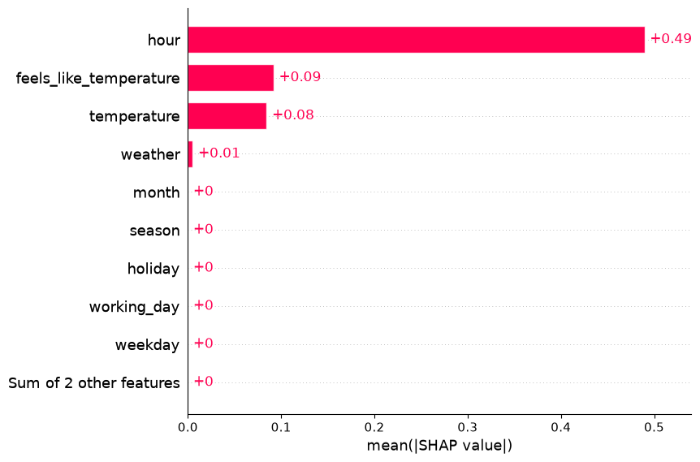

# Task recipes

Choose the model, primary metric and reports for your target, then pass them to
`train_model`. The short recipes share the setup below. A
[complete Frequency example](#complete-frequency-example) spells out selection,
tuning, reporting and model packaging without requiring that setup.

## Choose a recipe

| Task | Model | Primary metric |
| --- | --- | --- |
| [Binary classification](#binary-classification) | `CatBoostClassificationModel` | `metrics_classification` |
| [Regression](#regression) | `CatBoostRegressionModel` | `metrics_regression` |
| [Frequency](#frequency) | `CatBoostLogLinkRegressionModel` | `metrics_frequency` |
| [Severity](#severity) | `CatBoostLogLinkRegressionModel` | Tweedie deviance with fixed power |
| [Positive–unlabeled](#positiveunlabeled-classification) | `CatBoostPUClassificationModel` | `PUMetric` with a population prior |

## Prepare source data

From an installed repository checkout, run `python -m examples.prepare_data`
once. The examples read cached sources and do not download data implicitly.

| Source | Target | Partition |
| --- | --- | --- |
| UCI Bike Sharing, 17,379 recorded hours | Rentals/hour, or high demand for binary classification | Three chronological folds and the latest 20% as test |
| UCI Online Retail, fixed 10% invoice sample | Positive unit price in GBP/item | Train before September 2011, validate in September, test from October |
| Your PU project | Known positives and unlabeled observations | Recorded project timestamps and an independently justified prior |

See the [Bike setup](api/models.md#prepare-real-observations) and
[retail setup](api/inflation.md#prepare-recorded-retail-prices) for features,
units and sampling. The PU recipe is a function requiring your own pool.

## Shared setup

Run this block, choose one short task recipe, then use
[Run the chosen recipe](#run-the-chosen-recipe). Set the MLflow tracking URI and
experiment before training. Compact recipes disable model packaging and leave
selection and tuning off; PSI, prediction evaluators and data analyzers still write reports.

<!-- example: configuration-shared -->

```python
from ml_toolkit.training import Holdout, TimeSeriesCV
from dataclasses import replace
from ml_toolkit.config import (
    FeatureLevelConfig,
    ReportingConfig,
    TrackingConfig,
    TrainingConfig,
)
from ml_toolkit.metrics import (
    MetricsSeverity,
    PUMetric,
    metrics_classification,
    metrics_frequency,
    metrics_severity,
)
from ml_toolkit.models import (
    CatBoostClassificationModel,
    CatBoostLogLinkRegressionModel,
    CatBoostPUClassificationModel,
    CatBoostRegressionModel,
)
from ml_toolkit.types import FloatArray

base_config = TrainingConfig(tracking=TrackingConfig(log_test_model=False, log_final_model=False))
base_params = {
    "iterations": 20,
    "depth": 2,
    "random_seed": 42,
    "thread_count": 2,
    "verbose": False,
    "allow_writing_files": False,
}
common = ReportingConfig(psi=True)
```
See [Configuration](api/configuration.md) for settings, [data splitting](api/splitting.md)
for partition rules, [Evaluation](evaluation/index.md) for prediction reports, and
[Data analysis](data-analysis/index.md) for distributions and drift.

## Binary classification

The example labels an observed hour as high demand when its recorded rental
count is at least 100. This fixed operational threshold is chosen before
splitting; the count and its components are excluded from features. Include
both classes in evaluated splits for finite ROC AUC; single-class splits return NaN.

<!-- example: configuration-classification -->

```python
from ml_toolkit.data_analysis import NumericalFeatureDistributions
from ml_toolkit.evaluation import (
    PrecisionRecall,
    F1Threshold,
    Calibration,
    Gains,
    Lift,
    ObservedFitted,
    TimeObservedFitted,
)
from examples.gallery_data import load_bike_pool
import polars as pl

data = load_bike_pool(download_if_missing=False)
data = data.with_target((data.y >= 100).cast(pl.Float64))
classification_config = replace(base_config, reporting=common)
splitter = TimeSeriesCV(data, n_splits=3, test_size=0.2)
config = classification_config
model_factory = CatBoostClassificationModel
params = {**base_params, "loss_function": "Logloss"}
metric = metrics_classification
feature_selector = None
param_space = None
prediction_evaluators = [
    PrecisionRecall(),
    F1Threshold(),
    Calibration(),
    Gains(),
    Lift(),
    ObservedFitted(),
    TimeObservedFitted(),
]
data_analyzers = [NumericalFeatureDistributions()]
```

## Regression

Ordinary regression supports signed targets. `metrics_regression` returns
weighted MAE, MSE, RMSE, R² and mean error (prediction minus target).

<!-- example: configuration-regression -->

```python
from ml_toolkit.data_analysis import NumericalFeatureDistributions
from ml_toolkit.evaluation import (
    ObservedFitted,
    TimeObservedFitted,
)
from examples.gallery_data import load_bike_pool

data = load_bike_pool(download_if_missing=False)

from ml_toolkit.metrics import metrics_regression

regression_config = replace(base_config, reporting=common)
splitter = TimeSeriesCV(data, n_splits=3, test_size=0.2)
config = regression_config
model_factory = CatBoostRegressionModel
params = {**base_params, "loss_function": "RMSE"}
metric = metrics_regression
feature_selector = None
param_space = None
prediction_evaluators = [
    ObservedFitted(),
    TimeObservedFitted(),
]
data_analyzers = [NumericalFeatureDistributions()]
```

## Severity

Use the recorded positive retail unit prices as monetary targets, with
`stock_code`, `country` and `quantity` as inputs. The test starts on 1 October
2011; the holdout uses September for validation and earlier invoices for
training. The validation row count comes from the canonical calendar split,
so whole invoices stay together. Feature diagnostics use quantity.

Use a Tweedie power consistent with the model loss and metric. Here `power=1.5`
allows zero targets and requires positive predictions and positive weighted
observed totals. Gamma deviance (`power=2`) requires strictly positive targets.

For strictly positive severity, set `loss_function="Gamma"` on the same
`CatBoostLogLinkRegressionModel` and set the reporting metric's `power=2.0`.
See [Gamma regression](api/models.md#gamma-regression) for CPU/GPU configuration,
predictions, validation requirements and saving models.

<!-- example: configuration-severity -->

```python
from ml_toolkit.data_analysis import NumericalFeatureDistributions
from ml_toolkit.evaluation import (
    Gains,
    Lift,
    ObservedFitted,
    TimeObservedFitted,
)
from examples.retail_data import load_retail_pool, load_retail_splits

data = load_retail_pool(download_if_missing=False)
retail_splits = load_retail_splits(download_if_missing=False)


def severity_metric(
    observed: FloatArray, prediction: FloatArray, weight: FloatArray
) -> MetricsSeverity:
    return metrics_severity(observed, prediction, weight, power=1.5)


severity_config = replace(
    base_config,
    reporting=replace(
        common, features=(FeatureLevelConfig("quantity", "numerical"),)
    ),
)
splitter = Holdout(
    data, val_size=len(retail_splits.validation), test_size="2011-10-01"
)
config = severity_config
model_factory = CatBoostLogLinkRegressionModel
params = {**base_params, "loss_function": "Tweedie:variance_power=1.5"}
metric = severity_metric
feature_selector = None
param_space = None
prediction_evaluators = [
    Gains(),
    Lift(),
    ObservedFitted(),
    TimeObservedFitted(),
]
data_analyzers = [NumericalFeatureDistributions()]
```

## Positive–unlabeled classification

Use `1` for known positives and `0` for unlabeled observations. Both groups
need positive weight in training and evaluated samples. `prior` is the positive
fraction in the population, not the fraction of labeled rows. Supply a prepared
project `Pool` and call `train_pu(data, prior=your_prior)` after setting up MLflow.
The function uses the same prior in the model and metric.

<!-- example: configuration-pu -->

```python
from ml_toolkit import Pool, TrainingResult, train_model
from ml_toolkit.evaluation import PUScoreDistribution, PUPositiveCapture


def train_pu(data: Pool, *, prior: float) -> TrainingResult:
    return train_model(
        splitter=TimeSeriesCV(data, n_splits=3, test_size=0.2),
        params={**base_params, "loss": "uPU", "pu_prior": prior},
        model_factory=CatBoostPUClassificationModel,
        metric=PUMetric(prior, loss="uPU"),
        run_name="project-pu",
        config=replace(base_config, reporting=common),
        prediction_evaluators=[PUScoreDistribution(), PUPositiveCapture()],
    )
```

The [PU report guide](evaluation/pu.md) explains what the two plots show.

## Frequency

Use nonnegative targets with a positive weighted total in every evaluated split.
The log-link adapter fits a training-only baseline and returns positive rates.

<!-- example: configuration-frequency -->

```python
from ml_toolkit.data_analysis import NumericalFeatureDistributions
from ml_toolkit.evaluation import (
    Gains,
    Lift,
    ObservedFitted,
    TimeObservedFitted,
)
from examples.gallery_data import load_bike_pool

data = load_bike_pool(download_if_missing=False)
frequency_config = replace(base_config, reporting=common)
splitter = TimeSeriesCV(data, n_splits=3, test_size=0.2)
config = frequency_config
model_factory = CatBoostLogLinkRegressionModel
params = {**base_params, "loss_function": "Poisson"}
metric = metrics_frequency
feature_selector = None
param_space = None
prediction_evaluators = [
    Gains(),
    Lift(),
    ObservedFitted(),
    TimeObservedFitted(),
]
data_analyzers = [NumericalFeatureDistributions()]
```

## Run the chosen recipe

This call uses the variables from your chosen short recipe. Executing this
page in order uses Frequency, the final recipe above. PU uses its explicit
`train_pu` function instead.

<!-- example: configuration-run -->

```python
import mlflow

from ml_toolkit import train_model

mlflow.set_tracking_uri("sqlite:///mlflow.db")
mlflow.set_experiment("ml-toolkit-task-recipes")
result = train_model(
    splitter=splitter,
    params=params,
    model_factory=model_factory,
    metric=metric,
    run_name="task-example",
    config=config,
    feature_selector=feature_selector,
    param_space=param_space,
    prediction_evaluators=prediction_evaluators,
    data_analyzers=data_analyzers,
)
print(
    {
        name: round(value, 4)
        for name, value in result.validation.mean_metrics.items()
    }
)
assert result.test_metrics is not None
print({name: round(value, 4) for name, value in result.test_metrics.items()})
```

<!-- output: configuration-run -->
```text
{'mean_absolute_error': 111.9625, 'mean_squared_error': 26246.4224, 'root_mean_squared_error': 155.9688, 'r2_score': 0.1234, 'mean_error': -56.8402, 'mean_poisson_deviance': 120.7394, 'd2_poisson_score': 0.1843, 'prediction_over_observed': 0.7438, 'lift_at_10': 1.6123, 'gain_at_10': 0.1612, 'normalized_gini': 0.6381}
{'mean_absolute_error': 144.2219, 'mean_squared_error': 42249.5587, 'root_mean_squared_error': 205.547, 'r2_score': 0.1309, 'mean_error': -75.6556, 'mean_poisson_deviance': 159.3838, 'd2_poisson_score': 0.1984, 'prediction_over_observed': 0.6959, 'lift_at_10': 1.7831, 'gain_at_10': 0.1783, 'normalized_gini': 0.7351}
```
<!-- /output -->

The two dictionaries contain validation averages and independent test scores.
Metrics, configuration and evaluator artifacts are written to a local MLflow
store. See [workflow results](api/training.md#use-the-result) and
[Tracking](api/tracking.md) to inspect a run.

## Complete Frequency example

This standalone configuration enables RFE, two Optuna trials per fold, PSI,
SHAP, the listed evaluators and main-model packaging. Install the `shap` extra.
The small budgets keep the demonstration reproducible; choose production budgets
for your own task. RFE's `min_features` is a lower bound, not a promised result.

<!-- example: configuration-frequency-full -->

```python
from ml_toolkit.training import TimeSeriesCV
from ml_toolkit.data_analysis import NumericalFeatureDistributions
from ml_toolkit.evaluation import (
    Gains,
    Lift,
    ObservedFitted,
    TimeObservedFitted,
)
from examples.gallery_data import load_bike_pool

data = load_bike_pool(download_if_missing=False)
from optuna import Trial
from ml_toolkit.config import (
    FigureConfig,
    ReportingConfig,
    ShapConfig,
    TrackingConfig,
    TrainingConfig,
    TuningConfig,
)
from ml_toolkit.feature_selection import RFESelector
from ml_toolkit.metrics import metrics_frequency
from ml_toolkit.models import CatBoostLogLinkRegressionModel
from ml_toolkit.training import importance_ranker
from ml_toolkit.types import ModelParams

frequency_config = TrainingConfig(
    tuning=TuningConfig(
        metric="mean_poisson_deviance",
        direction="minimize",
        n_trials=2,
        timeout_seconds=None,
        seed=42,
    ),
    reporting=ReportingConfig(
        figure=FigureConfig(figsize=None, dpi=150, format="png"),
        features=None,
        psi=True,
        period="month",
        n_bins=10,
        epsilon=1e-06,
        shap=ShapConfig(
            max_samples=500, seed=42, max_display=10, dependence_features=()
        ),
    ),
    tracking=TrackingConfig(
        log_trial_models=False,
        log_validation_models=False,
        log_test_model=True,
        log_final_model=True,
        input_example_rows=5,
        model_name="model",
        registered_model_name=None,
        conda_env=None,
    ),
)
splitter = TimeSeriesCV(
    data,
    n_splits=3,
    val_size=None,
    test_size=0.2,
    gap=0,
    max_train_size=None,
    skip_splits=0,
)
config = frequency_config
model_factory = CatBoostLogLinkRegressionModel
params = {
    "iterations": 20,
    "depth": 2,
    "random_seed": 42,
    "thread_count": 2,
    "verbose": False,
    "allow_writing_files": False,
    "loss_function": "Poisson",
}
metric = metrics_frequency
feature_selector = RFESelector(
    min_features=1,
    metric="mean_poisson_deviance",
    direction="minimize",
    ranker=importance_ranker,
    max_fits=2,
    score_tolerance=0.0,
    protected_features=(),
)


def param_space(trial: Trial) -> ModelParams:
    return {
        "depth": trial.suggest_int("depth", 1, 3),
        "learning_rate": trial.suggest_float(
            "learning_rate", 0.03, 0.1, log=True
        ),
    }


prediction_evaluators = [
    Gains(),
    Lift(),
    ObservedFitted(),
    TimeObservedFitted(),
]
data_analyzers = [NumericalFeatureDistributions()]
```

## Inspect the complete run

Run the complete Frequency block immediately above, then this example. It
prints the selected settings and independent test metric, and renders SHAP
importance from at most 500 test rows. Contributions are in the native raw
log-rate units.

<!-- example: configuration-full-run -->

```python
from pathlib import Path
import mlflow
from ml_toolkit import train_model
from ml_toolkit.explainability import calculate_shap_values
from ml_toolkit.plots.explainability import shap_importance

mlflow.set_tracking_uri("sqlite:///mlflow.db")
mlflow.set_experiment("ml-toolkit-task-recipes")
result = train_model(
    splitter=splitter,
    params=params,
    model_factory=model_factory,
    metric=metric,
    run_name="frequency-full-example",
    config=config,
    feature_selector=feature_selector,
    param_space=param_space,
    prediction_evaluators=prediction_evaluators,
    data_analyzers=data_analyzers,
)
assert result.feature_selection is not None
assert result.tuning is not None
assert result.test_metrics is not None
print("Selected features:", result.features)
print(
    "Visited subset sizes:",
    [len(step.features) for step in result.feature_selection.steps],
)
print("Best trial:", result.tuning.best_trial)
print(
    "Test Poisson deviance:",
    round(result.test_metrics["mean_poisson_deviance"], 4),
)
test = splitter.get_test().heldout
assert test is not None
selected_test = test.select_features(result.features)
shap_config = config.reporting.shap
explanation = calculate_shap_values(
    result.model.native_model, selected_test.X, config=shap_config
)
shap_importance(
    explanation, Path("frequency-full-shap.png"), config=shap_config
)
```

<!-- output: configuration-full-run -->
```text
Selected features: ('temperature', 'feels_like_temperature', 'humidity', 'wind_speed', 'hour', 'working_day', 'weekday', 'holiday', 'season', 'weather', 'month')
Visited subset sizes: [11, 1]
Best trial: 0
Test Poisson deviance: 114.3487
```
<!-- /output -->



`steps` includes every subset tried in the last fold; the winning subset can
contain more than `min_features`. `best_trial` is zero-based. The main model
reuses the last fold's selected settings. Its packaged form preserves the
prediction behavior shown in the [Models guide](api/models.md#log-and-reload-for-serving).

Find fold results, tuning trials, configuration and reports in the
[MLflow run hierarchy](api/tracking.md#inspect-a-training-run). See
[feature selection](api/feature-selection.md), [parameter tuning](api/tuning.md)
and [SHAP](evaluation/explainability.md) for independent usage and customization.
