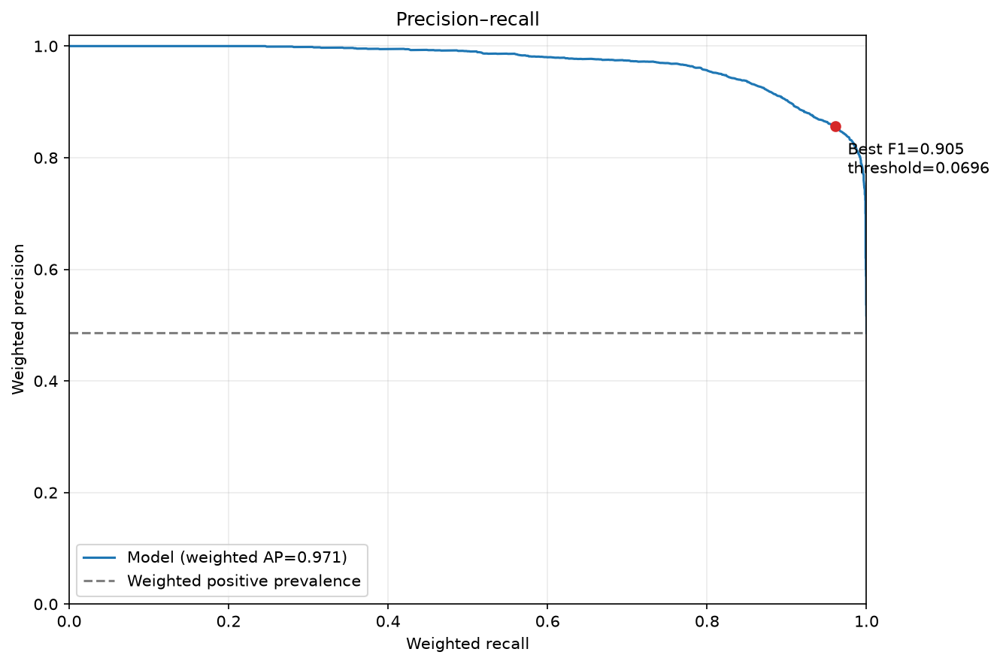
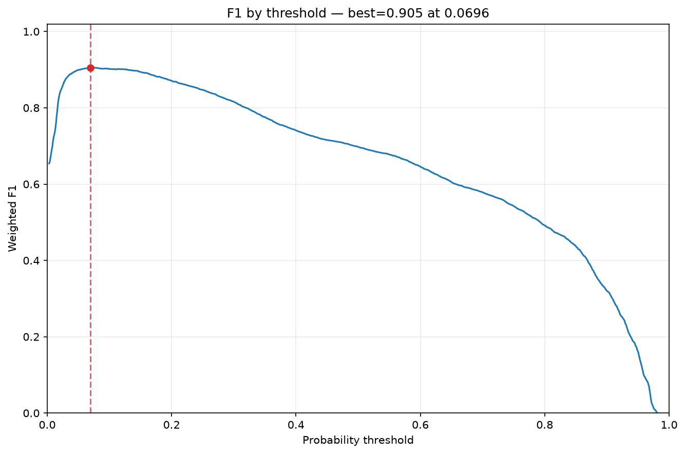
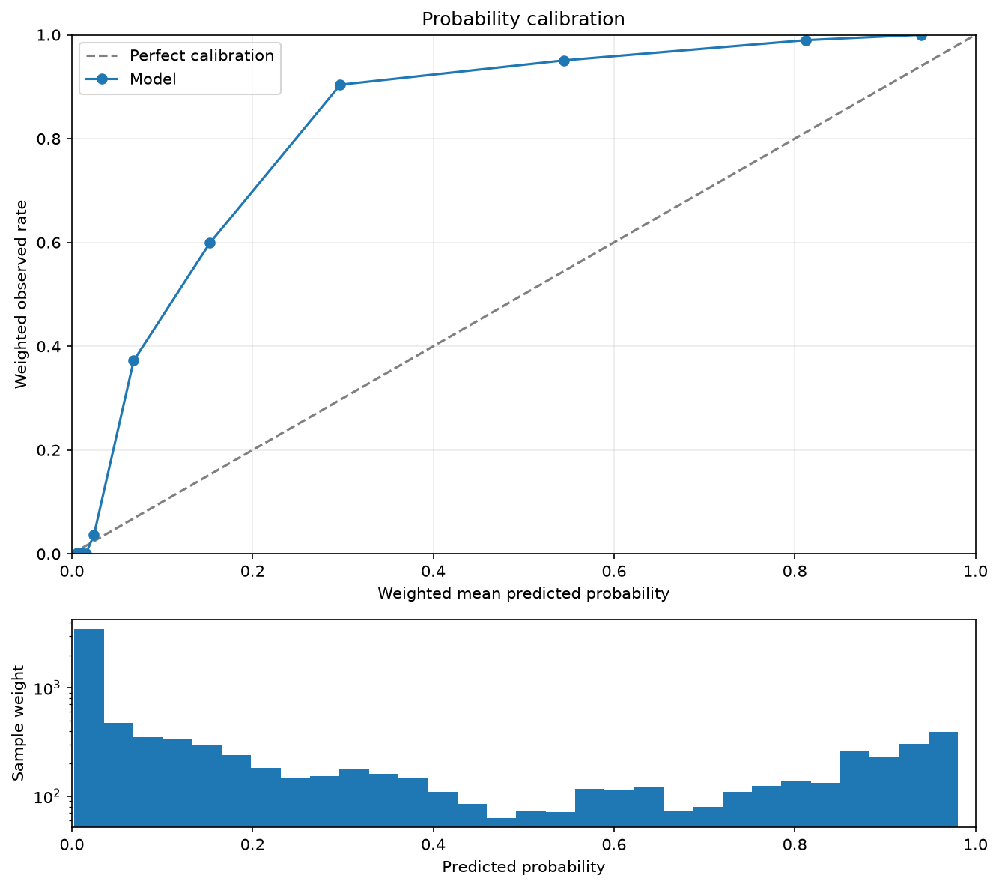

# Classification

Inspect a binary classifier's probability thresholds and calibration on held-out
observations. The target must contain confirmed `0`/`1` labels; predictions must
be finite positive-class probabilities in `[0, 1]`. These reports do not apply to
unverified PU labels.

## Prepare predictions

Run from the installed repository checkout after the [data preparation](index.md#example-data).
The example fits recorded 2011 hours and evaluates 2012 hours. A positive hour means at least 200 rentals. All curves below use
only the 2012 test probabilities; the model never fits those rows.

<!-- example: classification-setup -->

```python
from pathlib import Path

import numpy as np
import polars as pl

from examples.evaluation_data import fit_bike_evaluation
from ml_toolkit.config import FigureConfig

example = fit_bike_evaluation(classification=True)
data, prediction, split = example.data, example.prediction, example.split
train, test = example.train, example.test
train_prediction = prediction[: len(train)]
test_prediction = prediction[len(train) :]
output = Path("figures")
figure = FigureConfig(dpi=150)
print(f"2011 train hours: {len(train)}; 2012 test hours: {len(test)}")
```

<!-- output: classification-setup -->
```text
2011 train hours: 8645; 2012 test hours: 8734
```
<!-- /output -->

## Reports in training

Use the following list as `prediction_evaluators=reports` in the
[training call](index.md#add-reports-to-training). To inspect the exact reports
without a tracking server, call their artifact methods on the prepared inputs:

<!-- example: classification-reports -->

```python
from ml_toolkit.evaluation import PrecisionRecall, F1Threshold, Calibration

reports = [PrecisionRecall(), F1Threshold(), Calibration()]
for report in reports:
    files = report.write_artifacts(
        data=data,
        prediction=prediction,
        split=split,
        artifact_dir=output / report.name,
        figure=figure,
        features=None,
        n_bins=10,
    )
    print(report.name, [path.relative_to(output).as_posix() for path in files])
```

<!-- output: classification-reports -->
```text
precision_recall ['precision_recall/test/precision_recall.png']
f1_threshold ['f1_threshold/test/f1_threshold.png']
calibration ['calibration/test/calibration.png']
```
<!-- /output -->

## Precision and recall

The x-axis is recall: the fraction of positive rows captured. The y-axis is
precision: the positive fraction of flagged rows. Each curve point corresponds
to a probability threshold. The dashed line shows positive prevalence, and the
marked point identifies the best F1 on this sample. Tied scores enter together,
with `prediction >= threshold` defining a positive prediction.



`PrecisionRecall(max_curve_points=1000)` limits rendered points, preserving the
full threshold table from the direct function. Draw the same figure directly:

<!-- example: classification-precision-recall -->

```python
from ml_toolkit.plots import classification

observed, probabilities = test.y.to_numpy(), test_prediction
precision_recall_table = classification.precision_recall(
    observed,
    probabilities,
    output / "direct-precision-recall.png",
    weight=test.weight.to_numpy(),
    figure=figure,
)
curve = classification.binary_curves(
    observed, probabilities, weight=test.weight.to_numpy()
)
print(
    curve.iloc[np.linspace(0, len(curve) - 1, 6, dtype=int)]
    .round(3)
    .to_string(index=False)
)
assert curve.equals(precision_recall_table)
```

<!-- output: classification-precision-recall -->
```text
 threshold  precision  recall    f1
     0.981      1.000   0.000 0.000
     0.729      0.995   0.391 0.561
     0.234      0.967   0.767 0.855
     0.051      0.831   0.981 0.900
     0.014      0.616   0.999 0.762
     0.003      0.486   1.000 0.654
```
<!-- /output -->

## F1 by threshold

F1 is the harmonic mean of precision and recall. This plot identifies threshold
tradeoffs on the supplied sample; adding the evaluator does not change the
model's decision threshold. Select a threshold using validation rather than
optimizing it on the test figure.



<!-- example: classification-f1 -->

```python
f1_table = classification.f1_threshold(
    observed,
    probabilities,
    output / "direct-f1-threshold.png",
    weight=test.weight.to_numpy(),
    figure=figure,
)
assert f1_table.equals(curve)
```

`F1Threshold(max_curve_points=1000)` has the same rendering limit and full-table
return behavior as precision/recall.

## Calibration

The calibration curve compares mean predicted probability with the observed
positive rate within score quantiles. The diagonal represents perfect
calibration. The accompanying histogram shows where prediction mass lies. Here most points lie above the
diagonal: the model underestimates the positive rate in those test-score bins.



<!-- example: classification-calibration -->

```python
calibration_table = classification.calibration(
    observed,
    probabilities,
    output / "direct-calibration.png",
    weight=test.weight.to_numpy(),
    n_bins=10,
    histogram_bins=30,
    figure=figure,
)
print(calibration_table.round(3).to_string(index=False))
```

<!-- output: classification-calibration -->
```text
 bin  observed_rate  predicted_rate  count  weight_sum
   0          0.002           0.006    874       874.0
   1          0.002           0.011    873       873.0
   2          0.001           0.016    873       873.0
   3          0.037           0.024    874       874.0
   4          0.372           0.068    873       873.0
   5          0.599           0.153    873       873.0
   6          0.904           0.297    874       874.0
   7          0.951           0.545    873       873.0
   8          0.990           0.813    873       873.0
   9          1.000           0.940    874       874.0
```
<!-- /output -->

`Calibration(n_bins=10, histogram_bins=30)` controls calibration quantiles and
histogram bins independently. Its `n_bins` is distinct from shared feature-level
binning in `ReportingConfig`.

Precision, recall, F1, prevalence, AP, calibration means and histograms use row
weights. Zero-weight rows are ignored. Calibration boundaries remain unweighted
quantiles of positive-weight rows; `count` counts those rows and `weight_sum`
reports their total weight. The direct calibration call returns this full table.

## Use probabilities from another dataset

Direct functions also accept non-temporal data. The original handwritten digits
example uses scikit-learn's 1,797 images, with digits 0–4 as class 0 and 5–9 as
class 1. A fixed stratified split trains on 1,078 images and evaluates the other
719; no artificial dates or `Pool` are needed to calculate its curve.

<!-- example: classification-digits -->

```python
from examples.gallery_data import load_gallery_data

digits, _ = load_gallery_data(download_if_missing=False)
digits_curve = classification.binary_curves(
    digits.observed, digits.probabilities
)
print(
    f"Training images: {len(digits.train_indices)}; held-out images: {len(digits.observed)}"
)
print(
    digits_curve.iloc[np.linspace(0, len(digits_curve) - 1, 6, dtype=int)]
    .round(3)
    .to_string(index=False)
)
```

<!-- output: classification-digits -->
```text
Training images: 1078; held-out images: 719
 threshold  precision  recall    f1
     0.999      1.000   0.003 0.006
     0.990      1.000   0.402 0.574
     0.944      1.000   0.804 0.892
     0.057      0.831   1.000 0.907
     0.008      0.623   1.000 0.767
     0.000      0.498   1.000 0.665
```
<!-- /output -->

## API reference

::: ml_toolkit.evaluation.PrecisionRecall
    options:
      heading_level: 3
      members: []

::: ml_toolkit.evaluation.F1Threshold
    options:
      heading_level: 3
      members: []

::: ml_toolkit.evaluation.Calibration
    options:
      heading_level: 3
      members: []

::: ml_toolkit.plots.classification
    options:
      heading_level: 3
      members: [binary_curves, precision_recall, f1_threshold, calibration]
