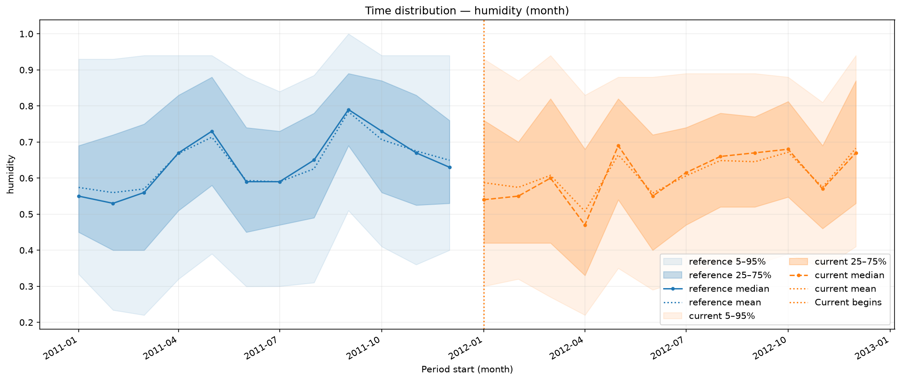

# Numerical distributions

Inspect the location and spread of a measured numerical feature over time.
`NumericalFeatureDistributions` compares train and held-out rows on their
recorded calendar axis. Its statistics are **unweighted**, independent of
`Pool.weight`, and use original feature values rather than fitted levels.

## Prepare observations

Run from the installed repository checkout after the [data preparation](index.md#example-data).
The example fits recorded 2011 hours and evaluates 2012 hours. Humidity is the source's normalized measurement. This report uses
feature observations, not predictions, although it shares the evaluator input
contract.

<!-- example: distributions-setup -->

```python
from pathlib import Path

import numpy as np
import polars as pl

from examples.evaluation_data import fit_bike_evaluation
from ml_toolkit.config import FigureConfig

example = fit_bike_evaluation(classification=False)
data, prediction, split = example.data, example.prediction, example.split
train, test = example.train, example.test
train_prediction = prediction[: len(train)]
test_prediction = prediction[len(train) :]
output = Path("figures")
figure = FigureConfig(dpi=150)
print(f"2011 train hours: {len(train)}; 2012 test hours: {len(test)}")
```

<!-- output: distributions-setup -->
```text
2011 train hours: 8645; 2012 test hours: 8734
```
<!-- /output -->

## Add a distribution report

Use `reports` as `prediction_evaluators` in
[training](index.md#add-reports-to-training), or write the reports directly:

<!-- example: distributions-reports -->

```python
from ml_toolkit.evaluation import NumericalFeatureDistributions

reports = [
    NumericalFeatureDistributions(features=("humidity",), period="month")
]
files = reports[0].write_artifacts(
    data=data,
    prediction=prediction,
    split=split,
    artifact_dir=output / reports[0].name,
    figure=figure,
    features=None,
    n_bins=10,
)
print([path.relative_to(output).as_posix() for path in files])
```

<!-- output: distributions-reports -->
```text
['numerical_feature_distributions/000_humidity.png']
```
<!-- /output -->



The x-axis shows calendar periods and the y-axis normalized humidity. Shaded
bands contain the 5th–95th and 25th–75th percentiles; lines mark the median and
mean. Here reference means 2011 train and current means 2012 test. Read seasonal
variation separately from a lasting distribution shift.

`features=None` selects numeric columns of `Pool.X`; a tuple restricts the
selection. Explicit missing or nonnumeric features raise an error. An empty
selection produces no figures. `quantile_bands`, `show_mean`, and `show_median`
control the visible summaries, and `period` sets the calendar grouping.
Shared feature-level definitions and `n_bins` are unused.

## Inspect the numerical summaries

<!-- example: distributions-direct -->

```python
from ml_toolkit.plots import monitoring

reference = train.X.with_columns(train.time.alias("timestamp"))
current = test.X.with_columns(test.time.alias("timestamp"))
time_distribution = monitoring.time_feature_distribution(
    reference,
    current,
    "humidity",
    "timestamp",
    output / "direct-humidity.png",
    period="month",
    figure=figure,
)
print(
    time_distribution.select("period_start", "split", "p50", "mean")
    .head(6)
    .with_columns(pl.col("mean").round(3))
    .write_csv(),
    end="",
)
```

<!-- output: distributions-direct -->
```text
period_start,split,p50,mean
2011-01-01T00:00:00.000000,reference,0.55,0.574
2011-02-01T00:00:00.000000,reference,0.53,0.56
2011-03-01T00:00:00.000000,reference,0.56,0.57
2011-04-01T00:00:00.000000,reference,0.67,0.668
2011-05-01T00:00:00.000000,reference,0.73,0.713
2011-06-01T00:00:00.000000,reference,0.59,0.593
```
<!-- /output -->

The returned Polars table has one row per observed sample/period with quantile
and mean columns. Nulls and non-finite values are omitted from statistics. Empty numerical groups have no computed values. Calendar ordering,
timezones and periods follow the [shared rules](index.md#figure-settings-and-time).

Use weekly groups and a single interquartile band when a finer view is useful:

<!-- example: distributions-weekly -->

```python
weekly = monitoring.time_feature_distribution(
    reference,
    current,
    "humidity",
    "timestamp",
    output / "time-humidity-week.png",
    period="week",
    quantile_bands=((0.25, 0.75),),
    show_mean=False,
    figure=figure,
)
print(weekly.select("period_start", "split", "p50").head(4).write_csv(), end="")
```

<!-- output: distributions-weekly -->
```text
period_start,split,p50
2010-12-27T00:00:00.000000,reference,0.77
2011-01-03T00:00:00.000000,reference,0.47
2011-01-10T00:00:00.000000,reference,0.5
2011-01-17T00:00:00.000000,reference,0.5
```
<!-- /output -->


## API reference

::: ml_toolkit.evaluation.NumericalFeatureDistributions
    options:
      heading_level: 3
      members: []

::: ml_toolkit.plots.monitoring
    options:
      heading_level: 3
      members: [time_feature_distribution]
