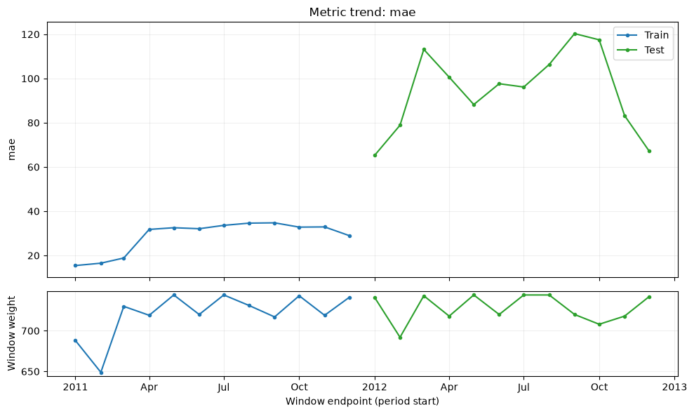

# Metrics over time

`MetricTrend` shows how the task's quality changes across calendar periods.
Each metric has a separate train, validation, or test curve, with the total
observation weight of each window below it. Use it to investigate whether a
good aggregate score hides months or weeks with worse predictions.

The report consumes existing predictions through `prediction_evaluators`.
Pass the same metric callback used by `train_model` so that the report and
ordinary scores use the same definitions and weights.

## Calculate a monthly trend

This example uses all recorded UCI Bike Sharing hours. The model fits 2011
and holds out 2012; MAE is measured in rentals per hour, with unit row weights.
Cache the source first with `python -m examples.prepare_data --dataset bike`.
The recipe never downloads missing data.

<!-- example: metric-trend-setup -->

```python
from pathlib import Path

from examples.custom_metric import weighted_mae
from examples.evaluation_data import fit_bike_evaluation
from ml_toolkit.evaluation import MetricTrend
from ml_toolkit.plots.metric_trend import metric_trend

example = fit_bike_evaluation()
output = Path("plots")
output.mkdir(exist_ok=True)
```

<!-- example: metric-trend-monthly -->

```python
report = MetricTrend(metric=weighted_mae, period="month", min_rows=100)
table = report.calculate(
    data=example.data,
    prediction=example.prediction,
    split=example.split,
)
table.write_parquet(output / "metric-trend-metrics.parquet")
metric_trend(
    table,
    metric="mae",
    period="month",
    save_fig=output / "metric-trend-mae.png",
)
assert table.height == 24
assert table["status"].unique().to_list() == ["ok"]
assert table["sum_weight"].sum() == len(example.data)
```



The upper panel shows MAE in each recorded month; the lower panel shows its
total weight, which equals the number of observed hours in this example.
Compare scores alongside that support. A short or low-volume period can have
a less stable metric than a larger one. The train and test curves describe
different samples of the same fitted model.

`calculate()` returns a long Polars table with one row per metric, split,
and observed period. The columns are:

| Column | Meaning |
| --- | --- |
| `period_start` | Beginning of the endpoint's calendar bucket |
| `window_start` | Beginning of the first calendar bucket included in that window |
| `split` | `train`, `val`, or `test` |
| `n_rows` | All rows in the window |
| `n_positive_weight_rows` | Rows with positive weight |
| `sum_weight` | Sum of observation weights |
| `metric` | Name returned by the task callback |
| `value` | Metric value, or null when unavailable |
| `status` | `ok`, `undefined`, `zero_weight`, or `insufficient_rows` |

Zero-weight windows and windows below `min_rows` do not call the metric. Their
support is retained and their values are null. Nonfinite callback results are
stored as null with status `undefined`; callback exceptions propagate with the
evaluator, split, and period endpoint. If every window is skipped, metric names
remain null and the report exports the table without metric figures.

## Use trailing calendar windows

`window` counts calendar buckets, including the current bucket. For a monthly
report, `window=3` includes the current month and the preceding two months.
Each score is recalculated from all rows in that window, preserving their
original weights. It is not an average of separately calculated monthly scores.

<!-- example: metric-trend-rolling -->

```python
rolling = MetricTrend(metric=weighted_mae, period="month", window=3, min_rows=100)
rolling_table = rolling.calculate(
    data=example.data,
    prediction=example.prediction,
    split=example.split,
)
assert rolling_table.height == table.height
assert rolling_table["n_rows"].max() > table["n_rows"].max()
```

Windows are calculated independently for each split, including a split boundary
inside a calendar period. A test window never borrows train rows. Initial
windows use the available rows from their own sample; `min_rows` applies to
positive-weight rows. Missing calendar periods have no calculated endpoints
and appear as gaps in the figures. Trailing windows count elapsed calendar
buckets, so a missing month still uses one position in a three-month window.

Supported periods are minute, hour, day, week, month, quarter, and year.
Minute/hour need `Datetime` timestamps. Other periods accept `Date` or
`Datetime`; weeks begin on Monday, quarters are calendar quarters, and grouping
preserves the input timezone, including daylight saving transitions.

## Add the report to training

<!-- example: metric-trend-workflow -->

```python
from examples.training_setup import prepare_training
from ml_toolkit import train_model
from ml_toolkit.models import CatBoostRegressionModel
from ml_toolkit.training import Holdout

data, params, config = prepare_training()
result = train_model(
    splitter=Holdout(data, test_size="2012-01-01"),
    params=params,
    model_factory=CatBoostRegressionModel,
    metric=weighted_mae,
    run_name="bike-metric-trend",
    config=config,
    prediction_evaluators=[
        MetricTrend(metric=weighted_mae, period="month", window=3, min_rows=100),
    ],
)
assert result.test_metrics is not None
```

Each enabled fit exports `metric_trend/metrics.parquet` and one indexed figure
per callback score, such as `metric_trend/000_mae.png`. Shared `FigureConfig`
controls output dimensions, resolution, and format. Stage switches, unique
report names, and artifact paths follow the [evaluation reporting contract](index.md#reporting-inputs-and-outputs).
The report calculates the table once while writing artifacts and adds no scalar
scores to training results, validation averages, or tuning objectives.

For quality by an exact-value segment, use
[`GroupedMetrics`](observed-fitted.md#metrics-by-group). For comparisons of
observed and predicted means over time, use
[`TimeObservedFitted`](observed-fitted.md).

## API reference

::: ml_toolkit.evaluation.MetricTrend
    options:
      members:
        - calculate
        - parameters

::: ml_toolkit.plots.metric_trend.metric_trend
