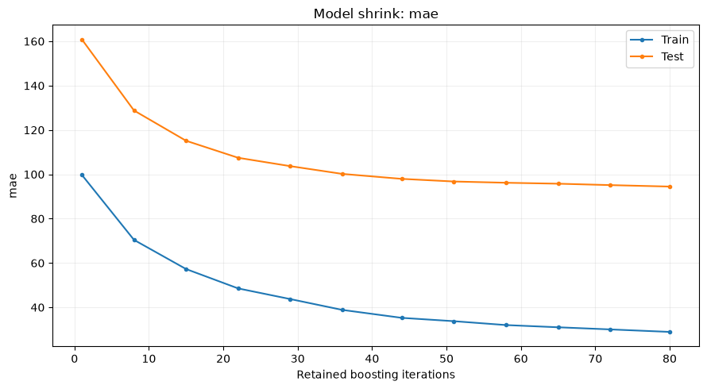

# Model evaluation and shrink curves

Use `model_evaluators` for reports that need the fitted adapter and the task's
metric callback. `ShrinkCurve` shows how those metrics change when retaining
fewer boosting iterations. It evaluates prefixes of the existing ensemble;
the original model and training results stay unchanged.

## Add a shrink report to training

This example uses the prepared UCI Bike Sharing data and the same weighted MAE
for training and the shrink report. Cache the source first with
`python -m examples.prepare_data --dataset bike`; recipes never download it.

<!-- example: shrink-workflow -->

```python
from examples.custom_metric import weighted_mae
from examples.training_setup import prepare_training
from ml_toolkit import train_model
from ml_toolkit.model_evaluation import ShrinkCurve
from ml_toolkit.models import CatBoostRegressionModel
from ml_toolkit.training import Holdout

data, params, config = prepare_training()
result = train_model(
    splitter=Holdout(data, test_size="2012-01-01"),
    params=params,
    model_factory=CatBoostRegressionModel,
    metric=weighted_mae,
    run_name="bike-shrink",
    config=config,
    model_evaluators=[ShrinkCurve(max_points=12)],
)
assert result.test_metrics is not None
```

Each enabled fit exports `shrink/metrics.parquet` and one indexed figure per
metric, such as `shrink/000_mae.png`. All scores returned by the task callback
are included, with separate curves for train and validation or test. Final
fits without held-out rows produce train-only curves. Undefined metric values
are null in the table and gaps in the figures. Prediction and metric errors
propagate with evaluator, iteration, and training-stage context.

## Choose how many sizes to evaluate

| Setting | Retained iteration counts |
| --- | --- |
| `ShrinkCurve()` | Up to 50 evenly spaced integer sizes, including 1 and the fitted size |
| `ShrinkCurve(max_points=20)` | Up to 20 evenly spaced sizes, with the same endpoints |
| `ShrinkCurve(step=100)` | 1, multiples of 100, and the fitted size |
| `ShrinkCurve(step=1)` | Every fitted size |
| `ShrinkCurve(sizes=(10, 50, 200))` | Those sizes, sorted, plus the fitted size |

Specify at most one sampling option. `max_points` is at least two; a model with
one iteration produces one point. Explicit sizes must be unique positive
integers within the actual fitted size, which may be smaller than the requested
training budget after early stopping. Fixed steps adapt to that fitted size.

Sizes count boosting iterations. They equal tree counts for the bundled
single-tree-per-iteration models. The original fitted size always appears, so
its curve values can be compared with the ordinary training metrics. A reduced
copy is held only while its scores are calculated; up to 50 points still require
up to 50 prediction passes per sample, so use a coarser grid for expensive data.

## Calculate and plot directly

The standalone example fits 80 iterations on 2011 hours and evaluates prefixes
on both 2011 and the untouched 2012 hours. It shares the original pool and split
labels with the existing evaluation examples.

<!-- example: shrink-direct-setup -->

```python
from pathlib import Path

from examples.evaluation_data import fit_bike_evaluation
from ml_toolkit.plots.model_evaluation import shrink_curve

example = fit_bike_evaluation()
output = Path("plots")
output.mkdir(exist_ok=True)
```

<!-- example: shrink-direct -->

```python
report = ShrinkCurve(max_points=12)
table = report.calculate(
    model=example.model,
    metric=weighted_mae,
    data=example.data,
    split=example.split,
)
table.write_parquet(output / "shrink-metrics.parquet")
shrink_curve(table, metric="mae", save_fig=output / "shrink-mae.png")
assert table.height == 24
assert table["n_iterations"].max() == example.model.n_iterations == 80
smaller_model = example.model.shrink(20)
assert smaller_model.n_iterations == 20
assert example.model.n_iterations == 80
```



The horizontal axis is the retained iteration count and the vertical axis is
MAE in rentals per hour. Compare the held-out curve with the train curve to
judge whether additional iterations help on these data. The report does not
choose a model size or reselect a classification threshold.

`calculate` returns a Polars table with `n_iterations` (Int64), `split` (String),
`metric` (String), and nullable `value` (Float64). Held-out-only and train-only
inputs work too. Splits must align with the pool and may contain `train` plus
at most one of `val` or `test`. Predictions use the adapter's original target
units and each split's row weights.

## Optional model capability

All bundled CatBoost adapters support `n_iterations` and `shrink(k)`, including
PU classification, log-link/Gamma regression, and inflation-adjusted models.
`LightGBMServingModel` supports these operations and `predict_pool` for direct
evaluation; it remains a serving adapter without a training interface.

`shrink(k)` returns an independent fitted copy retaining the first `k`
iterations. It preserves fitted baselines, prediction transformations,
classification thresholds, and inflation state. Reduced copies clear stale
validation F1, return `None` when the historical best iteration was removed,
and use the retained size as their refit budget. These settings survive model
serialization. A subsequent `fit` resets the retained-size override.

Custom adapters may implement the structural `ShrinkableModel` protocol without
inheriting from it. Keep all fitted preprocessing and inverse transformations
in the returned adapter, and validate `k` as an integer from 1 through the
current size. The existing `Model` contract does not require this capability.
An enabled `ShrinkCurve` raises `TypeError` with implementation guidance when
it is missing; disabling the report does not inspect model capabilities.

## Build another model evaluator

Subclass `ModelEvaluator` and override either method as needed. `evaluate`
receives keyword arguments `model`, `metric`, `data`, and `split`, and returns
additional finite scalar metrics. `write_artifacts` receives those same inputs
plus `artifact_dir` and `figure`, and returns only the files to upload.
`parameters()` describes JSON-compatible settings. Instances retain settings
only and may be reused across folds.

Pass one evaluator, a list, `None`, or `[]`. Reports run after prediction
evaluators and before data analyzers, under the same `ReportingConfig` stage
switches. Names must be unique across all report lists and enabled PSI/SHAP.
Settings are saved in `configuration/model_evaluators.json`. Additional scalar
scores and artifacts use the evaluator's namespace and do not enter training
results, CV averages, or tuning objectives. Shared figure settings and artifact
path checks match the [prediction evaluation contract](index.md#reporting-inputs-and-outputs).

## API reference

::: ml_toolkit.model_evaluation.ModelEvaluator

::: ml_toolkit.model_evaluation.ShrinkCurve

::: ml_toolkit.models.ShrinkableModel

::: ml_toolkit.plots.model_evaluation.shrink_curve
