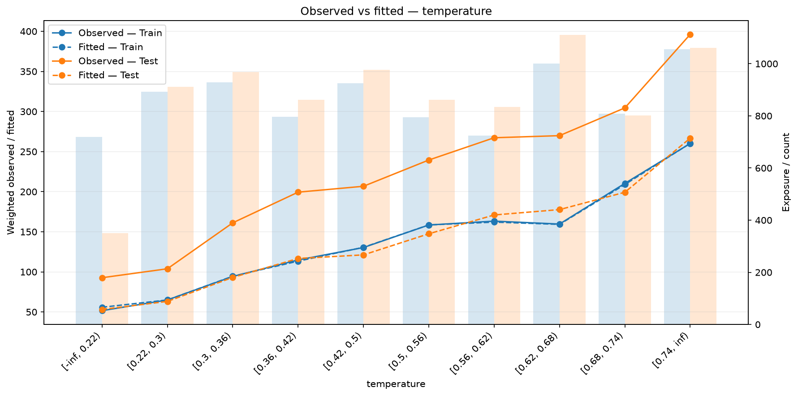
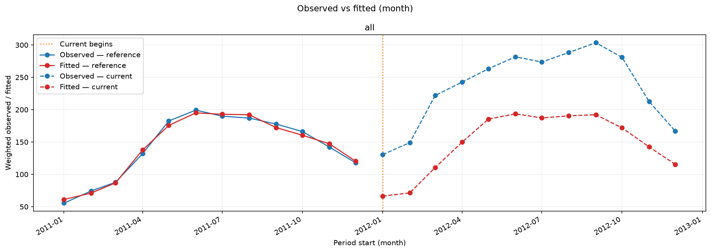

# Observed versus fitted

Compare actual and predicted weighted means to find segments or time periods
where a model systematically overpredicts or underpredicts. Each figure shows
train and one held-out sample together. Returned tables include the volume
supporting each group.

## Prepare predictions

Run from the installed repository checkout after the [data preparation](index.md#example-data).
The example fits recorded 2011 hours and evaluates 2012 hours. Targets and predictions are rentals per hour. The RMSE model can
produce negative predictions; the reports display its raw outputs.

<!-- example: observed-fitted-setup -->

```python
from pathlib import Path

import numpy as np
import polars as pl

from examples.evaluation_data import fit_bike_evaluation
from ml_toolkit.config import FigureConfig

example = fit_bike_evaluation(classification=False)
data, prediction, split = example.data, example.prediction, example.split
train, test = example.train, example.test
train_prediction = prediction[: len(train)]
test_prediction = prediction[len(train) :]
output = Path("figures")
figure = FigureConfig(dpi=150)
print(f"2011 train hours: {len(train)}; 2012 test hours: {len(test)}")
```

<!-- output: observed-fitted-setup -->
```text
2011 train hours: 8645; 2012 test hours: 8734
```
<!-- /output -->

## Compare feature levels

`ObservedFitted(features=("temperature",))` requests a temperature report. Its
feature list selects what to show; shared `FeatureLevelConfig` rules and `n_bins`
control how levels are learned. Fit levels on train only and apply the same
boundaries to test. Numerical quantiles, categories, missing values, and unseen
categories follow the [feature-level rules](../api/psi.md#reuse-feature-levels).

Pass `reports` to [training](index.md#add-reports-to-training), or write the
same reports directly from aligned predictions:

<!-- example: observed-fitted-reports -->

```python
from ml_toolkit.config import FeatureLevelConfig
from ml_toolkit.evaluation import ObservedFitted, TimeObservedFitted

features = (FeatureLevelConfig("temperature", "numerical"),)
reports = [
    ObservedFitted(features=("temperature",)),
    TimeObservedFitted(period="month"),
]
for report in reports:
    files = report.write_artifacts(
        data=data,
        prediction=prediction,
        split=split,
        artifact_dir=output / report.name,
        figure=figure,
        features=features,
        n_bins=10,
    )
    print([path.relative_to(output).as_posix() for path in files])
```

<!-- output: observed-fitted-reports -->
```text
['observed_fitted/000_temperature.png']
['time_observed_fitted/time.png']
```
<!-- /output -->



The x-axis is the ordered feature level. Curves show weighted observed and fitted
means for train and test; bars show total row weight. A curve above the observed
mean indicates overprediction. A sparse group's mean is less well supported.
Here fitted train means closely follow observations, while fitted test means
fall below observed rental demand across most temperature levels.
Missing levels and groups with zero total weight have zero volume and no mean.

Get the aggregate table with the direct function:

<!-- example: observed-fitted-levels -->

```python
from ml_toolkit.feature_levels import LevelTransformer
from ml_toolkit.plots import regression

levels = LevelTransformer(features, n_bins=10).fit(train.X)
train_levels, test_levels = levels.transform(train.X), levels.transform(test.X)
assert levels.feature_levels is not None
by_level = regression.observed_fitted_by_level(
    train_levels["temperature"],
    train.y.to_numpy(),
    train_prediction,
    test_levels["temperature"],
    test.y.to_numpy(),
    test_prediction,
    output / "direct-observed-fitted.png",
    level_order=levels.feature_levels[0].levels,
    feature_name="temperature",
    reference_weight=train.weight.to_numpy(),
    current_weight=test.weight.to_numpy(),
    current_label="Test",
    figure=figure,
)
print(by_level.head(5).round(2).to_string(index=False))
print(by_level.groupby("sample")[["volume"]].sum().to_string())
```

<!-- output: observed-fitted-levels -->
```text
   sample        level  observed  fitted  volume
reference [-inf, 0.22)     51.63   55.86   720.0
reference  [0.22, 0.3)     64.96   64.98   892.0
reference  [0.3, 0.36)     94.29   94.58   929.0
reference [0.36, 0.42)    114.84  113.37   796.0
reference  [0.42, 0.5)    130.35  130.63   925.0
           volume
sample
current    8734.0
reference  8645.0
```
<!-- /output -->

The pandas table uses `reference`/`current` sample keys even when the legend says
Train/Test. During training, O/F and PSI use separate `LevelTransformer` instances
fitted on the same training rows, `ReportingConfig.features` rules and
`ReportingConfig.n_bins`. PSI reuses its model baseline transformer when packaging
is enabled. O/F and PSI produce identical levels for matching features, but do
not share fitted state with each other. A direct
`LevelTransformer` fit also reproduces those levels when both its reference
data and settings match. See [how levels are shared](../api/psi.md#how-psi-and-observedfitted-share-levels)
for fitting and reuse across samples and folds.
`features=None` displays all shared feature definitions; an empty selection
produces no feature figures. Explicit unknown feature names raise an error.

## Compare calendar periods

`TimeObservedFitted(period="month")` summarizes targets and predictions by
recorded calendar period. The lines show weighted means; the returned table
also reports total weight. `TimeObservedFitted(by=("season",))` creates a
separate panel for each exact-value group. Names may refer to `Pool.X` or
`Pool.auxiliary_features`. Multiple names group by their combinations; an empty
tuple gives an overall plot. For continuous values, prepare a categorical band
column as shown in the [data guide](../api/data.md#grouping-by-prepared-bands).
`max_groups=50` limits the number of combinations across train and held-out rows.



The time plot's legend uses reference/current for the two samples. Here those
mean 2011 train and 2012 test. Dates, timezone, ordering, and incomplete periods
follow the [shared temporal rules](index.md#figure-settings-and-time).

<!-- example: observed-fitted-time -->

```python
temporal = regression.time_observed_fitted(
    train.time.to_list(),
    train.y.to_numpy(),
    train_prediction,
    test.time.to_list(),
    test.y.to_numpy(),
    test_prediction,
    output / "direct-time-observed-fitted.png",
    reference_weight=train.weight.to_numpy(),
    current_weight=test.weight.to_numpy(),
    period="month",
    figure=figure,
)
print(
    temporal[["period_start", "split", "observed", "fitted", "volume"]]
    .head(6)
    .round({"observed": 2, "fitted": 2})
    .to_string(index=False)
)
print("Monthly groups:", len(temporal))
```

<!-- output: observed-fitted-time -->
```text
period_start     split  observed  fitted  volume
  2011-01-01 reference     55.51   61.14   688.0
  2011-02-01 reference     74.29   71.09   649.0
  2011-03-01 reference     87.73   86.73   730.0
  2011-04-01 reference    131.95  137.63   719.0
  2011-05-01 reference    182.56  175.70   744.0
  2011-06-01 reference    199.32  195.05   720.0
Monthly groups: 24
```
<!-- /output -->

## Metrics by group

`GroupedMetrics` applies an ordinary metric function to each group and split.
It accepts the same exact-value `by` selection as the time report, independently
of shared numerical level settings. No metric function changes are required.

<!-- example: observed-fitted-grouped-metrics -->

```python
from ml_toolkit.evaluation import GroupedMetrics
from ml_toolkit.metrics import metrics_regression

grouped_report = GroupedMetrics(
    name="metrics_by_season",
    metric=metrics_regression,
    by=("season",),
    min_rows=30,
)
grouped_table = grouped_report.calculate(
    data=data, prediction=prediction, split=split
)
assert grouped_table.filter(pl.col("status") == "ok").height > 0
```

Pass this evaluator through `prediction_evaluators` to log finite scalar scores
and upload `metrics.parquet` beneath its report name. The table preserves typed
grouping columns and includes `group_id`, `split`, `n_rows`,
`n_positive_weight_rows`, `sum_weight`, `metric`, `value`, and `status`.
`group_id` identifies the same group across splits within that report; identifiers
are local to the report and are not persistent segment IDs across folds.

`min_rows=1` by default counts positive-weight rows. Each represented split
includes every observed group, even if that split has no rows in the group.
Statuses are `ok`, `empty`, `zero_weight`, `insufficient_rows`, or `undefined`.
Skipped and nonfinite results have null values; if every group is skipped,
metric names are null too. A single-class group's ROC AUC is undefined, while
its other valid scores remain available. Exceptions raised by the metric
function propagate with report context. Only finite scores are logged under
`<name>/<split>/<group_id>/<metric_key>`; the table retains original metric names.
Unusual metric names are encoded into collision-free tracking keys.
Grouping column names must not conflict with the table's metadata columns;
give such a diagnostic column a distinct name before grouping.

Grouped metrics are additional diagnostics, including on train-only fits. They
do not change training metrics, CV averages, or optimization objectives.

::: ml_toolkit.evaluation.GroupedMetrics
    options:
      members: [calculate]

The table exposes `period_start` for each group. Optional weights affect means
and volume. Feature-level plots use shared `n_bins`; the time plot has its own
`period` and does not use feature-level settings.

## Compare two held-out periods directly

Direct plotting can compare two evaluation periods without including model
training rows. This independent Bike model fits January–June 2011; the
reference is July–December 2011 and the current period is 2012. Both plotted
samples are held out. Fitting feature levels on the reference makes the
comparison answer how its relationships generalize to the subsequent year.

<!-- example: observed-fitted-heldout-setup -->

```python
from examples.gallery_data import load_gallery_data

_, bikes = load_gallery_data(download_if_missing=False)
reference, current = bikes.reference.features, bikes.current.features
reference_y, current_y = bikes.reference.observed, bikes.current.observed
reference_prediction, current_prediction = (
    bikes.reference.prediction,
    bikes.current.prediction,
)
```

<!-- example: observed-fitted-heldout-levels -->
```python
from ml_toolkit.plots import regression
from ml_toolkit.config import FeatureLevelConfig
from ml_toolkit.feature_levels import LevelTransformer

heldout_levels = LevelTransformer(
    (FeatureLevelConfig("temperature", "numerical"),), n_bins=10
).fit(reference)
reference_levels = heldout_levels.transform(reference)
current_levels = heldout_levels.transform(current)
assert heldout_levels.feature_levels is not None
heldout_by_level = regression.observed_fitted_by_level(
    reference_levels["temperature"],
    reference_y,
    reference_prediction,
    current_levels["temperature"],
    current_y,
    current_prediction,
    output / "observed-fitted-levels.png",
    level_order=heldout_levels.feature_levels[0].levels,
    feature_name="Normalized temperature",
    reference_label="Jul–Dec 2011",
    current_label="2012",
    figure=figure,
)
print(heldout_by_level.groupby("sample")[["volume"]].sum().to_string())
print(heldout_by_level.head(4).round(2).to_string(index=False))
```

<!-- output: observed-fitted-heldout-levels -->
```text
           volume
sample
current    8734.0
reference  4395.0
   sample        level  observed  fitted  volume
reference  [-inf, 0.3)     77.76   71.07   369.0
reference  [0.3, 0.36)    109.52  100.87   407.0
reference [0.36, 0.42)    135.91  120.76   444.0
reference  [0.42, 0.5)    145.87  140.84   515.0
```
<!-- /output -->


The legend names the actual periods. This direct plot is a reference/current
comparison, separate from the train/test evaluator above.

## API reference

::: ml_toolkit.evaluation.ObservedFitted
    options:
      heading_level: 3
      members: []

::: ml_toolkit.evaluation.TimeObservedFitted
    options:
      heading_level: 3
      members: []

::: ml_toolkit.plots.regression
    options:
      heading_level: 3
      members: [observed_fitted_by_level, time_observed_fitted]
