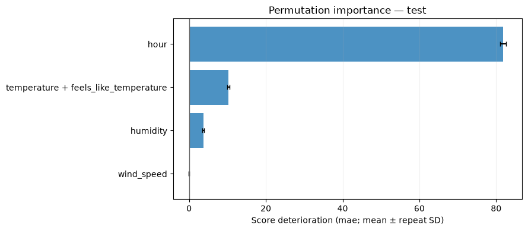

# Permutation importance

`PermutationImportance` measures how much a fitted model's held-out score
changes when selected feature values are shuffled. It uses the same prediction
adapter and task metric as training, including fitted transformations and row
weights. Positive importance means worse quality after shuffling; negative
importance means better quality on this sample.

## Add the report to training

The example uses the cached UCI Bike Sharing data and weighted MAE in rentals
per hour. Prepare the source once with
`python -m examples.prepare_data --dataset bike` before running recipes.

<!-- example: permutation-workflow -->

```python
from examples.custom_metric import weighted_mae
from examples.training_setup import prepare_training
from ml_toolkit import train_model
from ml_toolkit.model_evaluation import PermutationImportance
from ml_toolkit.models import CatBoostRegressionModel
from ml_toolkit.training import Holdout

data, params, config = prepare_training()
result = train_model(
    splitter=Holdout(data, test_size="2012-01-01"),
    params=params,
    model_factory=CatBoostRegressionModel,
    metric=weighted_mae,
    run_name="bike-permutation",
    config=config,
    model_evaluators=PermutationImportance(
        score="mae",
        direction="minimize",
        features=("hour", "humidity", "wind_speed"),
        groups=(("temperature", "feels_like_temperature"),),
        n_repeats=3,
        max_samples=4000,
    ),
)
assert result.test_metrics is not None
```

Each enabled validation/test run exports
`permutation_importance/importance.parquet` and `importance.png`. Train-only
fits are skipped. Supply a score name returned by the task callback and its
preferred direction: `minimize` for MAE or deviance, `maximize` for AUC. Each
instance evaluates one score; separate instances can use different scores and
report names. No model is retrained or selected.

## Calculate and plot directly

This example fits 80 boosting iterations to 2011 hours and measures importance
on unseen 2012 hours. Temperature and feels-like temperature are shuffled as
one group, using the same row permutation to preserve their relationship.

<!-- example: permutation-direct-setup -->

```python
from pathlib import Path

from examples.evaluation_data import fit_bike_evaluation
from ml_toolkit.plots.permutation_importance import permutation_importance

example = fit_bike_evaluation()
output = Path("plots")
output.mkdir(exist_ok=True)
```

<!-- example: permutation-direct -->

```python
report = PermutationImportance(
    score="mae",
    direction="minimize",
    features=("hour", "humidity", "wind_speed"),
    groups=(("temperature", "feels_like_temperature"),),
    n_repeats=3,
    max_samples=4000,
    seed=42,
)
importance = report.calculate(
    model=example.model,
    metric=weighted_mae,
    data=example.data,
    split=example.split,
)
permutation_importance(importance, save_fig=output / "permutation-mae.png")
assert importance.height == 12
assert importance["n_rows"].unique().to_list() == [4000]
```



Bars show the mean score deterioration; error bars show the standard deviation
over repeated permutations. These are repeat variability, not confidence
intervals. The chart measures the fixed model's reliance on these inputs on
this sample. Correlated alternatives may mask individual importance, so group
features when their joint contribution is the relevant question. Permutation
can also create feature combinations absent from the original data; interpret
results with the feature relationships in mind.

## Sampling, grouping and outputs

`features=None` evaluates every model column not already included in `groups`.
Use `features=()` to evaluate only the configured groups. Feature groups must
be nonempty and disjoint, and explicitly selected individual columns cannot
also belong to a group. Auxiliary columns are never passed to the model.

`max_samples` limits positive-weight held-out rows with uniform sampling without
replacement; zero-weight rows are excluded from the permutation population.
All permutations and the baseline use the same sampled rows,
original targets and original weights. `seed` makes both sampling and
permutations reproducible. For G groups and R repeats, the report needs
`1 + G * R` prediction passes on that sample. It retains no fitted state.

`calculate` returns one row per group/repeat with columns `split`, `group_id`,
`features` (a list of column names), `repeat` (zero-based), `metric`, `baseline`,
`value`, `importance`, `n_rows`, and `sum_weight`. Importance is shuffled minus
baseline for minimization and baseline minus shuffled for maximization.
Nonfinite scores are null, with unavailable importances shown explicitly in
the figure. Missing score names and prediction/metric failures raise errors.

The report follows the shared [model evaluation](model.md) stage switches,
namespace, figure configuration, and artifact upload rules.

## API reference

::: ml_toolkit.model_evaluation.PermutationImportance
    options:
      members: [calculate, parameters]

::: ml_toolkit.plots.permutation_importance.permutation_importance
