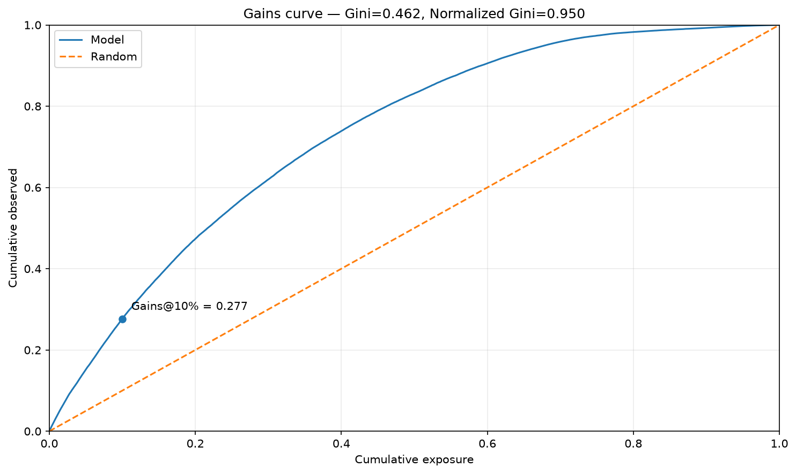
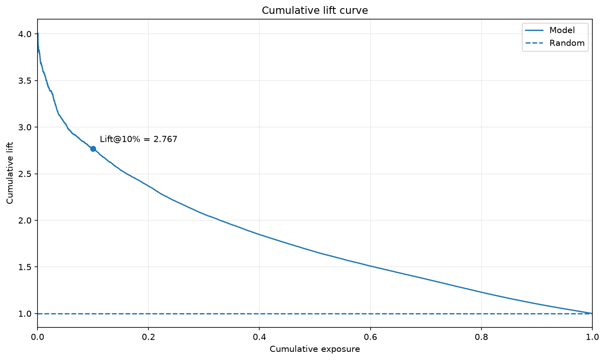

# Ranking

Rank rows by their predicted outcome and measure how much observed outcome falls
within a limited review or service capacity. `Gains` and `Lift` require finite,
nonnegative targets and a positive weighted observed total. They use confirmed
outcomes; [PU capture](pu.md) has a different meaning.

## Prepare predictions

Run from the installed repository checkout after the [data preparation](index.md#example-data).
The example fits recorded 2011 hours and evaluates 2012 hours. The target is rentals per hour and each row has unit exposure, so
capacity is a fraction of hours. The reports rank only the 2012 test hours.

<!-- example: ranking-setup -->

```python
from pathlib import Path

import numpy as np
import polars as pl

from examples.evaluation_data import fit_bike_evaluation
from ml_toolkit.config import FigureConfig

example = fit_bike_evaluation(classification=False)
data, prediction, split = example.data, example.prediction, example.split
train, test = example.train, example.test
train_prediction = prediction[: len(train)]
test_prediction = prediction[len(train) :]
output = Path("figures")
figure = FigureConfig(dpi=150)
print(f"2011 train hours: {len(train)}; 2012 test hours: {len(test)}")
```

<!-- output: ranking-setup -->
```text
2011 train hours: 8645; 2012 test hours: 8734
```
<!-- /output -->

## Gains and lift reports

Use this list as `prediction_evaluators=reports` in
[training](index.md#add-reports-to-training). These calls produce the same report
files from existing predictions:

<!-- example: ranking-reports -->

```python
from ml_toolkit.evaluation import Gains, Lift

reports = [Gains(), Lift()]
for report in reports:
    files = report.write_artifacts(
        data=data,
        prediction=prediction,
        split=split,
        artifact_dir=output / report.name,
        figure=figure,
        features=None,
        n_bins=10,
    )
    print([path.relative_to(output).as_posix() for path in files])
```

<!-- output: ranking-reports -->
```text
['gains/test/gains.png']
['lift/test/lift.png']
```
<!-- /output -->

### Gains

The x-axis is cumulative exposure after sorting from highest to lowest score.
The y-axis is the share of total `observed × exposure` captured. The diagonal
shows uniform selection. A curve above it captures more outcome with the same
capacity; the marked 10% point summarizes a common operating capacity.



### Lift

Lift divides captured outcome share by the exposure share. A value of 2 means
capturing twice the outcome expected from uniform selection at that capacity.



## Inspect the curves and selected capacities

<!-- example: ranking-curves -->

```python
from ml_toolkit.metrics import ranking_metrics
from ml_toolkit.plots import ranking

ranked = ranking_metrics(
    test.y.to_numpy(), test_prediction, test.weight.to_numpy()
)
ranking.gains_curve(ranked, output / "direct-gains.png", figure=figure)
ranking.lift_curve(ranked, output / "direct-lift.png", figure=figure)
print(
    [
        (point.percent, round(point.gain, 3), round(point.lift, 3))
        for point in ranked.selected_points
    ]
)
selected = ranking_metrics(
    test.y.to_numpy(),
    test_prediction,
    test.weight.to_numpy(),
    selected_percents=(10.0, 20.0),
)
print(
    [
        (point.percent, round(point.gain, 3), round(point.lift, 3))
        for point in selected.selected_points
    ]
)
```

<!-- output: ranking-curves -->
```text
[(10.0, 0.277, 2.767)]
[(10.0, 0.277, 2.767), (20.0, 0.473, 2.367)]
```
<!-- /output -->

`ranking_metrics` returns cumulative arrays and selected points; plotting calls
return `None`. Selected points interpolate at the requested exposure fraction.
Zero-exposure rows are omitted and tied predictions retain input order.
The evaluator classes use the default 10% point; direct plotting accepts any
`RankingMetrics` result, including other selected capacities.

## API reference

::: ml_toolkit.evaluation.Gains
    options:
      heading_level: 3
      members: []

::: ml_toolkit.evaluation.Lift
    options:
      heading_level: 3
      members: []

::: ml_toolkit.plots.ranking
    options:
      heading_level: 3
      members: [gains_curve, lift_curve]

See [ranking calculations](../api/metrics.md#inspect-gains-lift-and-gini) for
the metric result and a small worked example.
