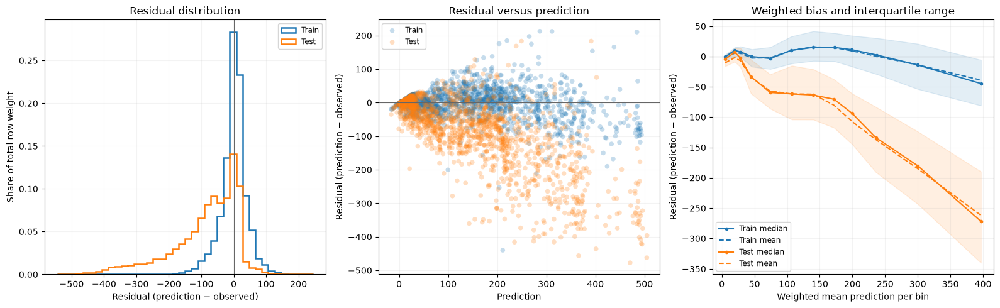

# Residuals and large loss contributions

Use `Residuals` to inspect the shape of regression errors, systematic bias at
different prediction levels, and observations contributing most to the chosen
loss. The report uses predictions already calculated by the training workflow.

## Add the report to training

This complete workflow uses recorded UCI Bike Sharing hourly counts and dates.
Cache the source with `python -m examples.prepare_data --dataset bike` before
running recipes; examples never download it implicitly.

<!-- example: residuals-workflow -->

```python
from examples.custom_metric import weighted_mae
from examples.training_setup import prepare_training
from ml_toolkit import train_model
from ml_toolkit.evaluation import Residuals
from ml_toolkit.models import CatBoostRegressionModel
from ml_toolkit.training import Holdout

data, params, config = prepare_training()
trained = train_model(
    splitter=Holdout(data, test_size="2012-01-01"),
    params=params,
    model_factory=CatBoostRegressionModel,
    metric=weighted_mae,
    run_name="bike-residuals",
    config=config,
    prediction_evaluators=Residuals(loss="squared", n_bins=12, max_rows=15),
)
assert trained.test_metrics is not None
```

The evaluator follows the shared `ReportingConfig` stage switches and figure
settings. Each enabled fit writes `rows.parquet`, `bins.parquet`, `worst.parquet`,
and `residuals.png` beneath `residuals/`. The parquet rows include observed
outcomes and optional object IDs.

## Read the residual diagnostics

For a reproducible direct example, fit 80 iterations on the recorded 2011 hours
and evaluate those predictions on both 2011 and untouched 2012 observations.
Every hour has weight one; outcomes and predictions are rentals per hour.

<!-- example: residuals-direct-setup -->

```python
from pathlib import Path

from examples.evaluation_data import fit_bike_evaluation
from ml_toolkit.plots.residuals import residual_diagnostics

example = fit_bike_evaluation()
output = Path("plots")
output.mkdir(exist_ok=True)
```

<!-- example: residuals-direct -->

```python
report = Residuals(loss="squared", n_bins=12, max_samples=1500, max_rows=15)
diagnostics = report.calculate(
    data=example.data,
    prediction=example.prediction,
    split=example.split,
)
residual_diagnostics(
    diagnostics,
    save_fig=output / "residuals-diagnostics.png",
    loss=report.loss,
    max_samples=report.max_samples,
)
assert diagnostics.rows.height == len(example.data)
assert diagnostics.worst.height == 30
assert diagnostics.worst["weight"].min() > 0
```



Positive residuals mean overprediction; negative residuals mean underprediction.
The first panel shows the share of each split's total row weight in common
residual bins. The scatter panel reveals whether errors change with prediction
size. Its uniformly sampled points are bounded by `max_samples` per split;
marker sizes represent relative row weights. Sampling affects only that panel.

The last panel shows the weighted median, interquartile band, and weighted mean
residual in prediction bins. Cutoffs are fitted from positive-weight train
predictions when present and shared across splits. Held-out-only calls use the
supplied positive-weight predictions. Repeated quantile cutoffs collapse, so a
constant prediction produces one bin. Extreme predictions fall into the first
or last bin. Train and test curves are compared at each split's weighted mean
prediction within the shared bin; their horizontal coordinates can differ.

## Inspect the tables

`calculate` returns a `ResidualResult` containing three Polars tables:

| Table | Contents |
| --- | --- |
| `rows` | Every original row, with position, split, timestamp, target, prediction, weight, residual, unit loss, weighted contribution, and prediction-bin ID. Includes `object_id` when the pool supplies it. |
| `bins` | Populated split/bin pairs with bounds, positive-weight row count, total weight, weighted mean prediction/residual/loss, total contribution, and residual quantiles. |
| `worst` | Up to `max_rows` positive-weight rows per split, ordered by decreasing weighted contribution, with original row order breaking ties. |

<!-- example: residuals-tables -->

```python
largest = diagnostics.worst.select(
    "split", "time", "observed", "prediction", "weight", "contribution"
)
largest.write_parquet(output / "residuals-largest.parquet")
assert diagnostics.bins["sum_weight"].sum() == example.data.weight.sum()
```

Quantiles use the inverse weighted empirical CDF: the smallest residual whose
cumulative weight reaches the requested share. `p05`, `p25`, `p50`, `p75`, and
`p95` correspond to 5%, 25%, 50%, 75%, and 95%. Zero-weight observations remain
in `rows` for positional alignment but do not enter statistics, figures, or
the largest-contribution table. Missing object IDs are not fabricated.

## Choose the loss and residual scale

| `loss` | Residual | Individual weighted contribution |
| --- | --- | --- |
| `"squared"` | Prediction minus observed target | Weight × squared error |
| `"absolute"` | Prediction minus observed target | Weight × absolute error |
| `"poisson"` | Signed square root of Poisson unit deviance | Weight × Poisson unit deviance |
| `"gamma"` | Signed square root of Gamma unit deviance | Weight × Gamma unit deviance |

Poisson requires nonnegative observations and strictly positive predicted
means. At observed zero its unit deviance is twice the predicted mean. Gamma
requires strictly positive observations and predicted means. Both deviance
residuals retain the prediction-minus-observation sign and equal zero at a
perfect fit. These domains apply to every supplied row, including rows with
zero weight. Squared and absolute error support signed outcomes and predictions.

Choose a loss explicitly for the regression task. The evaluator does not infer
it from the model's training parameters or from the metric callback. A Poisson
loss report therefore needs predictions on the positive mean scale, rather
than raw log predictions. The report supports train-only or held-out-only data,
preserves inputs, and adds no scalar optimization objectives.

## API reference

::: ml_toolkit.evaluation.Residuals
    options:
      members: [calculate, parameters, evaluate, write_artifacts]

::: ml_toolkit.evaluation.ResidualResult
    options:
      members: []

::: ml_toolkit.plots.residuals.residual_diagnostics
