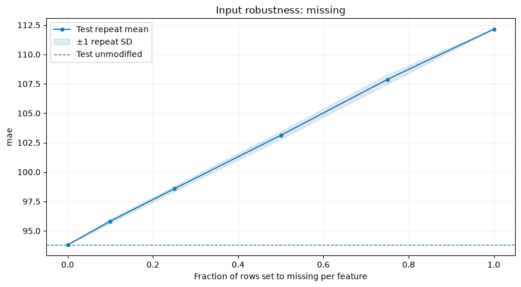

# Input robustness

`RobustnessCurve` measures task metrics after explicit changes to held-out
features. Use it to assess missing inputs, measurement noise, reduced precision,
or categories absent from the supplied data. The fitted model is reused at every
level; its parameters and the original data stay unchanged.

## Add a stress report to training

The example uses the original UCI Bike Sharing hourly observations, weather
features, and rental counts. Cache the source first with
`python -m examples.prepare_data --dataset bike`. It fits on earlier hours and
reserves 2012 as test; the report applies the configured scenario only to held-out
rows and keeps the task's weighted MAE and original target values.

<!-- example: robustness-workflow -->

```python
from examples.custom_metric import weighted_mae
from examples.training_setup import prepare_training
from ml_toolkit import train_model
from ml_toolkit.model_evaluation import RobustnessCurve
from ml_toolkit.models import CatBoostRegressionModel
from ml_toolkit.training import Holdout

data, params, config = prepare_training()
result = train_model(
    splitter=Holdout(data, test_size="2012-01-01"),
    params=params,
    model_factory=CatBoostRegressionModel,
    metric=weighted_mae,
    run_name="bike-input-robustness",
    config=config,
    model_evaluators=RobustnessCurve(
        features=("temperature", "humidity"),
        mode="missing",
        levels=(0.0, 0.1, 0.25, 0.5),
        n_repeats=3,
        seed=42,
    ),
)
assert result.test_metrics is not None
```

Each enabled validation/test fit exports `robustness/metrics.parquet` and one
indexed figure per metric, such as `robustness/000_mae.png`. The shared
`ReportingConfig` stage switches and `FigureConfig` apply. A train-only final
fit skips this report. Use distinct report names for several scenarios.

## Calculate and plot a scenario directly

This fixed model fits 80 iterations on 2011 hours and reports on 2012 hours.
The stress scenario independently hides temperature and humidity at each chosen
fraction. The resulting points describe this explicit scenario applied to the
real held-out rows, rather than a forecast of how the input source will fail.

<!-- example: robustness-direct-setup -->

```python
from pathlib import Path

from examples.evaluation_data import fit_bike_evaluation
from ml_toolkit.plots.robustness import robustness_curve

example = fit_bike_evaluation()
output = Path("plots")
output.mkdir(exist_ok=True)
```

<!-- example: robustness-direct -->

```python
report = RobustnessCurve(
    features=("temperature", "humidity"),
    mode="missing",
    levels=(0.0, 0.1, 0.25, 0.5, 0.75, 1.0),
    n_repeats=5,
    max_samples=2500,
    seed=42,
)
table = report.calculate(
    model=example.model,
    metric=weighted_mae,
    data=example.data,
    split=example.split,
)
table.write_parquet(output / "robustness-metrics.parquet")
robustness_curve(table, metric="mae", save_fig=output / "robustness-missing.png")
assert table.height == 31
assert table["n_rows"].unique().to_list() == [2500]
```



The vertical axis is MAE in rentals per hour. The dashed line uses unmodified
features on the same 2,500 sampled hours as every scenario. The solid line is
the mean over five random realizations, and the band is one repeat standard
deviation. It shows variability of the chosen perturbation, rather than an
uncertainty interval for future model quality. Undefined metric values leave
gaps.

## Scenario settings

| Mode | Meaning of `levels` | Supported features |
| --- | --- | --- |
| `missing` | Probability in [0, 1] of setting each selected feature value to null | Any model feature |
| `noise` | Nonnegative Gaussian-noise scale, in training standard deviations | Numerical model features |
| `rounding` | Nonnegative integer decimal places; fewer means coarser precision | Numerical model features |
| `unknown` | Probability in [0, 1] of replacing a category with `unknown_value` | Categorical model features |

Levels are unique and finite. Masks/noise are reused across levels within each
repeat, so larger missing fractions hide nested row sets. `n_repeats` defaults
to three; deterministic rounding is evaluated once per level. `max_samples`
defaults to 10,000 uniformly sampled positive-weight held-out rows; `None` uses
all positive-weight held-out rows. Zero-weight rows are excluded before sampling
and perturbation. An all-zero held-out sample raises an error. Row selection
occurs once, and targets, weights, dates, IDs, and auxiliary columns remain
aligned throughout. `seed` controls both row selection and perturbations.

Noise uses the weighted population standard deviation of finite,
positive-weight training values. It therefore requires train rows even for
direct calculation. Constant features have zero noise scale; nulls remain
null. Rounding and noise may promote changed numerical columns to Float64.

<!-- example: robustness-numerical-scenarios -->

```python
noise = RobustnessCurve(
    features=("temperature",), mode="noise", levels=(0.0, 0.25, 0.5, 1.0),
    n_repeats=3, max_samples=2500, seed=42,
)
rounding = RobustnessCurve(
    features=("humidity",), mode="rounding", levels=(0.0, 1.0, 2.0),
    max_samples=2500,
)
for scenario in (noise, rounding):
    scenario_table = scenario.calculate(
        model=example.model, metric=weighted_mae,
        data=example.data, split=example.split,
    )
    assert scenario_table["metric"].unique().to_list() == ["mae"]
```

Unknown mode injects an unseen label, defaulting to `"unknown"`. The label must
not already occur in any supplied value of the selected features. Changed
categorical columns are converted to String in the temporary input only,
including Enum/Categorical and integer-coded categories. Their categorical
feature metadata is preserved. CatBoost can predict unseen labels; LightGBM's
categorical preparation uses its missing-category behavior for unseen values.
Custom adapters must support the chosen scenario through `predict_pool`.

The following example explicitly treats the recorded weather code as a
categorical feature before fitting a separate model:

<!-- example: robustness-category-scenario -->

```python
from dataclasses import replace

import numpy as np

categorical_data = replace(
    example.data,
    cat_features=("weather",),
    numerical_features=tuple(name for name in example.data.X.columns if name != "weather"),
)
categorical_model = CatBoostRegressionModel({
    "iterations": 40, "depth": 4, "random_seed": 42, "thread_count": 2,
    "verbose": False, "allow_writing_files": False,
}).fit(categorical_data.take(np.flatnonzero((example.split == "train").to_numpy())))
unknown = RobustnessCurve(
    features=("weather",), mode="unknown", levels=(0.0, 0.1, 0.5, 1.0),
    unknown_value="unknown", n_repeats=3, max_samples=2500, seed=42,
)
unknown_table = unknown.calculate(
    model=categorical_model, metric=weighted_mae,
    data=categorical_data, split=example.split,
)
assert unknown_table.height == 13
```

## Calculated values

`calculate` returns a Polars table containing `split`, `mode`, `level`, `repeat`,
`is_baseline`, `metric`, `value`, `delta`, `n_rows`, and `sum_weight`. `n_rows`
counts the selected positive-weight held-out rows. Baseline
rows have null level/repeat and `is_baseline=True`. Other rows identify the
scenario level and zero-based repeat. Values use natural metric units and
the original row weights; `delta` is scenario value minus baseline. Positive
delta worsens a minimized metric and improves a maximized metric. Nonfinite
scores and deltas become null, while prediction/metric exceptions propagate
with scenario context.

Reports calculate the curve once during artifact generation and do not add
scalar scores to training results or tuning objectives. `parameters()` returns
the settings, and evaluator instances retain no fitted state.

## API reference

::: ml_toolkit.model_evaluation.RobustnessCurve
    options:
      members: [calculate, parameters]

::: ml_toolkit.plots.robustness.robustness_curve
